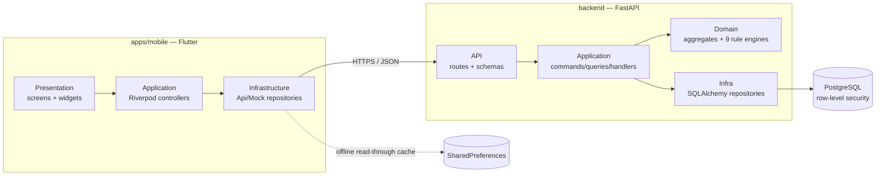

<div align="center">

# 🏋️ Gym Companion

**A fitness companion built on a deterministic, explainable rule engine — not a chatbot, not a
black-box recommendation model.**

A FastAPI backend implementing Clean Architecture, paired with a Flutter mobile client covering
six feature modules. Every non-trivial architectural decision made while building it is recorded
as one of 55 ADRs.

[](https://github.com/Saivk25/GYMCompanion/actions/workflows/ci.yml)
[](LICENSE)
[](backend/pyproject.toml)
[](apps/mobile/pubspec.yaml)
[](backend/pyproject.toml)
[](backend/pyproject.toml)
[](docs/adr/README.md)
[](CONTRIBUTING.md)

[Architecture](docs/ARCHITECTURE.md) · [ADR Index](docs/adr/README.md) · [Tech Debt](docs/TECH_DEBT.md) · [Contributing](CONTRIBUTING.md) · [Security](SECURITY.md)

</div>

---

> **Screenshots and a demo GIF are not yet available.** The Flutter app has never been run on a
> real device or simulator — see [Known limitations](#known-limitations) below and
> [`docs/screenshots/README.md`](docs/screenshots/README.md) for the exact planned set and why.
> This README links to real, current documentation instead of placeholder images.

## What this is

Gym Companion tracks training, nutrition, body-composition progress, and readiness (sleep,
energy, stress, soreness), and surfaces **deterministic, rule-based** coaching signals — every
recommendation is produced by an explicit, testable rule (e.g. "protein below 50 g" or "acute:
chronic training load ratio above 1.5"), never a machine-learning model or an LLM. An `app/ai/`
adapter-layer package is reserved in the backend for a possible future vision/language provider
integration, but **no AI/ML functionality is implemented today** — this project intentionally
avoids describing itself as "AI-powered" until that's literally true.

It was built first for a single user, with the explicit intent of generalizing later only once
the single-user version is proven — see
[`docs/design-docs/Gym_Companion_Engineering_Master_Plan.docx`](docs/design-docs/) for the full
product rationale.

## Features

Six feature modules, each with a real backend aggregate and (except Coach) a real HTTP
repository integration on the mobile side — see the table in
[`docs/ARCHITECTURE.md` §3](docs/ARCHITECTURE.md#3-feature-boundaries) for the exact, current
status of every module, including known gaps.

| Module | What it does |
|---|---|
| **Today** | Daily landing screen — today's planned session, an outstanding readiness check-in prompt, an understated streak indicator. |
| **Train** | Plan and log workouts: pre-session tier choice, active-workout set logging with a rest timer, session summaries. |
| **Fuel** | Manual nutrition logging (meals, water) against real per-entry backend records — no AI photo recognition exists (see above). |
| **Progress** | Body-composition and measurement tracking with real trend charts computed from logged history. |
| **Readiness** | Daily check-in (sleep, energy, stress, soreness, resting heart rate, HRV) feeding a deterministic readiness rule engine. |
| **Coach** | A cross-module feed of the real, explainable advisory signals the other five rule engines already produced — never a chat interface. |

Under the hood, the backend runs **nine independent, deterministic rule engines** (Readiness,
Nutrition, Goal Alignment, Progressive Overload, Safety, Progress Evaluation, Training Load,
Exercise Recommendation, plus the shared Rule Engine foundation) — see
[`docs/adr/0013`–`0021`](docs/adr/README.md).

## Tech stack

**Backend** — Python 3.10+, [FastAPI](https://fastapi.tiangolo.com/), SQLAlchemy 2.0, Alembic
migrations, PostgreSQL (with row-level security for tenant isolation), Pydantic v2, JWT
(`pyjwt`) + bcrypt authentication, [Ruff](https://docs.astral.sh/ruff/) (lint + format), `mypy
--strict`, pytest.

**Mobile** — Flutter 3.24+, Riverpod 2.5 (no code generation — see
[`docs/adr/0003`](docs/adr/0003-flutter-state-management.md)), `go_router` (nested
`StatefulShellRoute` navigation), `dio` (HTTP), `shared_preferences` (offline read-through
cache), `flutter_secure_storage` (refresh token), a hand-tuned design system (no
`ColorScheme.fromSeed`, no bundled font).

**Infrastructure** — Docker Compose for local Postgres, Alembic for schema migrations, GitHub
Actions for CI (see [CI/CD](#cicd)).

## Architecture



This is the condensed view. The full architecture document —
[`docs/ARCHITECTURE.md`](docs/ARCHITECTURE.md) — covers the complete provider graph, routing
graph, repository-to-endpoint mapping, the networking/caching/auth layers in detail, the design
system, and Mermaid sequence diagrams for all six major user flows (Today, Train, Fuel,
Progress, Readiness, Coach).

## Folder structure

```text
GYM/
├── backend/            FastAPI service — Clean Architecture (domain/application/infra/api)
├── apps/mobile/         Flutter client — the same layering per feature
├── docs/
│   ├── ARCHITECTURE.md  Full architecture reference (start here for onboarding)
│   ├── adr/              55 Architecture Decision Records + README.md navigation index
│   ├── TECH_DEBT.md     14 tracked, deliberately-deferred items with trigger conditions
│   ├── RELEASE_PROCESS.md
│   ├── screenshots/     Planned screenshot/GIF set (not yet captured — see its README)
│   └── design-docs/     The six founding design documents (product/domain/UX/engineering)
├── infra/                docker-compose.yml for local Postgres
├── scripts/              Dev scripts (local Postgres bootstrap, migration safety check)
├── .github/              CI workflows, issue/PR templates, CODEOWNERS, Dependabot
├── assets/, datasets/, models/   Scaffolded per docs/adr/0001, not yet populated
└── tests/e2e/             Scaffolded, not yet populated
```

Full annotated tree: [`docs/ARCHITECTURE.md` §2](docs/ARCHITECTURE.md#2-repository-layout).

## Installation

### Prerequisites

- Python 3.10+ and Docker (for backend + local Postgres), **or** a local Postgres install
- Flutter 3.24+ (backend and mobile are independent — you don't need both to work on one)

### Backend

```bash
git clone https://github.com/Saivk25/GYMCompanion.git
cd GYMCompanion/backend
python3 -m venv ~/.venvs/gym-backend
~/.venvs/gym-backend/bin/pip install -e ".[dev]"
cp .env.example .env   # adjust GYM_DATABASE_URL once Postgres is running
```

Local Postgres, either works:

```bash
# Option A — Docker Compose (from repo root)
cd infra && docker compose up --build

# Option B — no Docker
scripts/local_postgres.sh start
```

Run migrations and start the API:

```bash
cd backend
alembic upgrade head
uvicorn app.main:app --reload
```

Verify: `curl http://localhost:8000/health`

### Mobile

```bash
cd apps/mobile
flutter pub get
```

**Real gap, stated plainly:** no `android`/`ios` platform folders exist in this repository yet
(see [Known limitations](#known-limitations)). Generate them before `flutter run` will work:

```bash
flutter create --platforms=android,ios .
flutter run
```

This has not been executed in this project's own primary build environment
([`docs/adr/0002`](docs/adr/0002-flutter-verification-constraint.md)) — every line of Dart in
this repository has been hand-authored and statically/structurally verified, never run. If
you're working from a machine with a real Flutter SDK, you have first-class verification the
original author didn't for most of this project's history; please run `flutter analyze` and
`flutter test` and report anything that fails.

### One-shot commands (repo root `Makefile`)

```bash
make backend-install       make backend-test          make backend-lint
make mobile-get             make mobile-test            make mobile-analyze
make precommit-install
```

## Documentation

| Document | What's in it |
|---|---|
| [`docs/ARCHITECTURE.md`](docs/ARCHITECTURE.md) | The full onboarding architecture reference — provider graph, routing graph, repository/networking/caching/auth layers, design system, sequence diagrams. |
| [`docs/adr/README.md`](docs/adr/README.md) | Navigable index of all 55 ADRs, grouped by phase. |
| [`docs/TECH_DEBT.md`](docs/TECH_DEBT.md) | 14 tracked, deliberately-deferred gaps, each with a concrete trigger condition — not a generic TODO list. |
| [`docs/RELEASE_PROCESS.md`](docs/RELEASE_PROCESS.md) | SemVer strategy, what blocks the first tagged release, GitHub Releases process. |
| [`backend/README.md`](backend/README.md) | Backend-specific setup and layout detail. |
| [`apps/mobile/README.md`](apps/mobile/README.md) | Mobile-specific setup and per-feature module notes. |
| [`docs/design-docs/`](docs/design-docs/) | The six founding planning documents (Product Bible, Domain Model Bible, UX/UI Design Bible, Engineering Master Plan, System Architecture, Design Document) — the source of truth for product decisions every ADR traces back to. |

## Roadmap

Concrete, sourced from [`docs/adr/0054`](docs/adr/0054-testing-and-release-readiness.md)'s
release checklist and [`docs/RELEASE_PROCESS.md`](docs/RELEASE_PROCESS.md) — not aspirational:

- [ ] Run a real Flutter SDK against this codebase (`flutter analyze` / `flutter test`) for the
      first time.
- [ ] Generate `android`/`ios` platform folders.
- [ ] Real-device accessibility pass (TalkBack/VoiceOver) — the current pass is static-analysis
      only ([`docs/adr/0053`](docs/adr/0053-performance-and-accessibility-audit.md)).
- [ ] App icon, splash screen, app-store metadata.
- [ ] A real backend deployment target (none exists today — see [`SECURITY.md`](SECURITY.md)).
- [ ] Golden tests (blocked on a real Flutter SDK to generate baseline images).
- [ ] Tag and cut the first release, `0.1.0` (see [`docs/RELEASE_PROCESS.md`](docs/RELEASE_PROCESS.md)).

## Known limitations

The honest, current list — see [`docs/TECH_DEBT.md`](docs/TECH_DEBT.md) for the full detail
behind each:

- **No live deployment.** Neither the backend nor the mobile client has been deployed/published
  anywhere (see [`SECURITY.md`](SECURITY.md)).
- **No Flutter SDK has run this codebase.** All ~50 Flutter files were hand-authored and
  statically verified, never compiled or executed
  ([`docs/adr/0002`](docs/adr/0002-flutter-verification-constraint.md)).
- **No exercise catalog or session-history-list endpoint** exists on the backend yet — Active
  Workout's set logging is honestly disabled rather than faked (TD-0007).
- **No AI/ML functionality** — see [What this is](#what-this-is) above; `app/ai/` is a reserved,
  empty adapter layer.
- Full list: 14 tracked items in `docs/TECH_DEBT.md`, each with its own trigger condition for
  when to act on it.

## Testing

- **Backend:** 291 test files, 2,000+ test functions, mirroring `app/`'s own layer structure
  1:1 (`tests/domain/`, `tests/application/`, `tests/infra/`, `tests/api/`,
  `tests/composition/`). CI enforces **100% statement/branch coverage on `app.domain`** and runs
  the full suite against a real Postgres service container (`.github/workflows/ci.yml`).
- **Mobile:** 30 test files, 240+ test cases (unit, widget, multi-screen flow, and — new as of
  [`docs/adr/0054`](docs/adr/0054-testing-and-release-readiness.md) —
  `flutter_test`'s `meetsGuideline` accessibility matchers on two representative screens). Uses
  hand-rolled fakes throughout, no mocking framework. **Never executed against a real Flutter
  SDK** — see [Known limitations](#known-limitations).
- **End-to-end:** scaffolded (`tests/e2e/`), not yet populated — blocked on the same real-device
  gap.

## Performance

[`docs/adr/0053`](docs/adr/0053-performance-and-accessibility-audit.md) is a **static-analysis
audit**, not a real-device profiling pass — no Flutter SDK/DevTools was available. It reviewed
provider rebuild scope, `StatefulShellRoute.indexedStack` behavior, chart repaint boundaries, and
the offline cache's interaction with this backend's unpaginated list endpoints, applying one
low-risk fix (a touch target below the design system's 48dp minimum) and documenting four other
findings as tracked debt (TD-0010–TD-0013) rather than making unreviewed changes. No throughput,
latency, or memory benchmarks exist yet — reporting fabricated numbers here would violate this
project's own "don't invent functionality/results" convention.

## Security

- JWT bearer-token authentication with automatic refresh-on-401, bcrypt password hashing
  ([`docs/adr/0032`](docs/adr/0032-authentication-and-authorization.md)).
- Per-resource ownership authorization on all 27 addressed-by-id backend routes — a caller can
  no longer read/modify another user's data by guessing an id
  ([`docs/adr/0033`](docs/adr/0033-resource-ownership-authorization.md)).
- Postgres row-level security, keyed on the authenticated session, for every per-tenant table
  (`backend/app/infra/database.py`'s `tenant_scope()`).
- The mobile client's refresh token is the only secret persisted to disk, via
  `flutter_secure_storage` (Keychain/Keystore-backed); the access token lives in memory only.

See [`SECURITY.md`](SECURITY.md) for the vulnerability-reporting process and current scope
(no live deployment exists yet, so today's attack surface is the source code and dependency
tree, not a running service).

## CI/CD

`.github/workflows/`:

| Workflow | What it checks |
|---|---|
| `ci.yml` | Backend lint/format/typecheck, backend tests against a real Postgres service container, a Docker build smoke test, `flutter analyze` + `flutter test`. |
| `codeql.yml` | CodeQL static security analysis (Python + JavaScript/TypeScript-adjacent config files). |
| `dependency-review.yml` | Flags newly-introduced vulnerable/incompatibly-licensed dependencies on pull requests. |
| `markdown-lint.yml` | Lints every `.md` file for structural/style issues. |
| `spellcheck.yml` | Spell-checks documentation and code comments. |
| `release.yml` | Runs on a `v*` tag push — builds the backend Docker image and drafts a GitHub Release from `CHANGELOG.md`. Does not deploy anywhere (no deployment target exists yet). |

Dependabot (`.github/dependabot.yml`) watches `pip` (backend), `pub` (mobile), the backend
Dockerfile, and GitHub Actions versions weekly.

## Contributing

Contributions are welcome — see [`CONTRIBUTING.md`](CONTRIBUTING.md) for setup, the local
quality-gate commands, and this project's architectural conventions. Please also read
[`CODE_OF_CONDUCT.md`](CODE_OF_CONDUCT.md).

## License

[MIT](LICENSE) © 2026 Sai

## Credits

Designed and built by **Sai**. The founding planning documents
([`docs/design-docs/`](docs/design-docs/)), all 55 ADRs, and most of the implementation were
produced through iterative, human-directed collaboration with **Claude** (Anthropic) as a
pair-programming and technical-writing partner — every decision was reviewed and approved by
the maintainer, not auto-generated unreviewed. Disclosed here for transparency, not as a
gimmick.

## Contact

- **Issues / feature requests:** [GitHub Issues](https://github.com/Saivk25/GYMCompanion/issues)
- **Security reports:** see [`SECURITY.md`](SECURITY.md) — do not open a public issue
- **Email:** <saibalaji250904@gmail.com>
