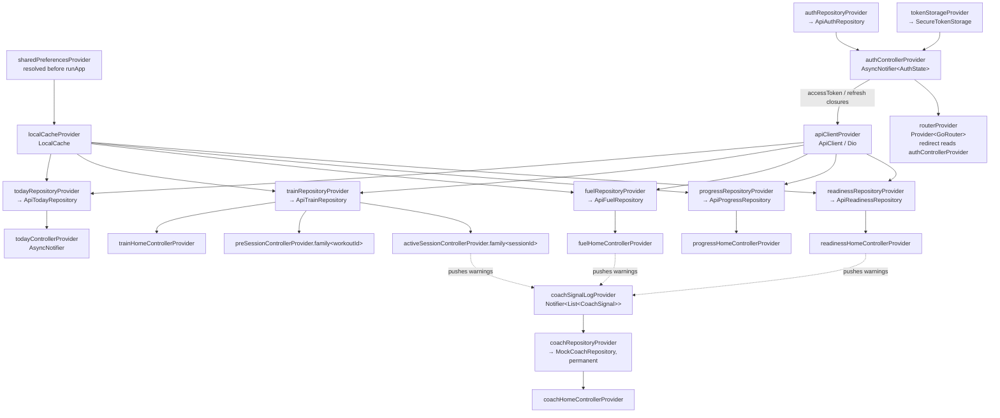
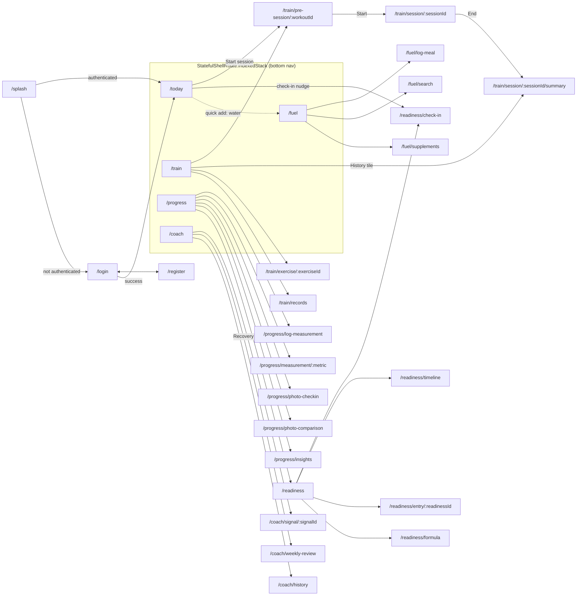
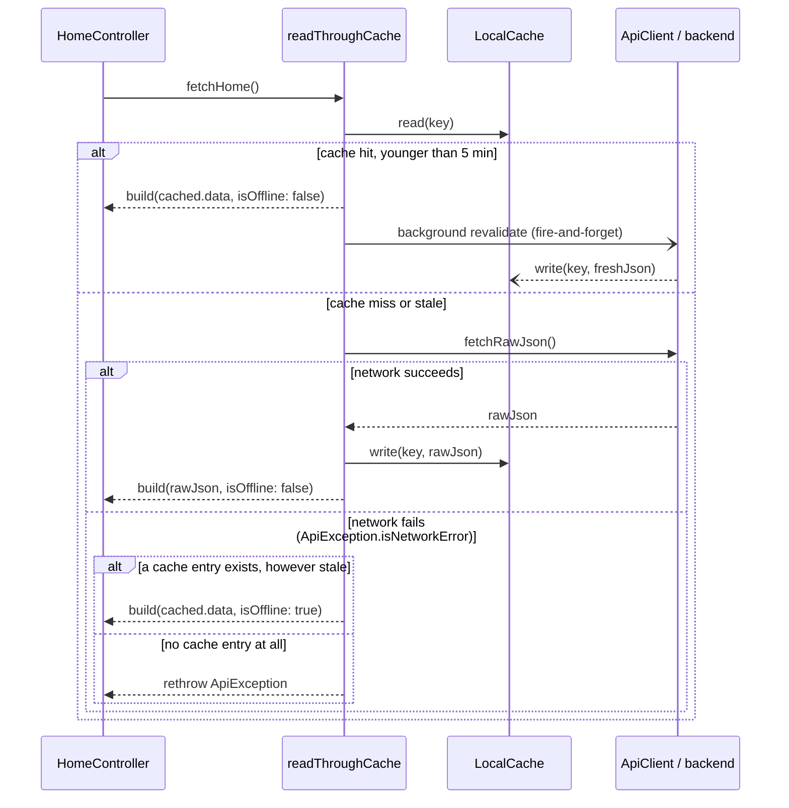
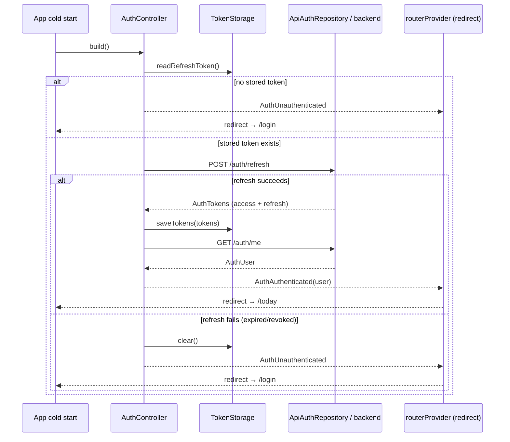
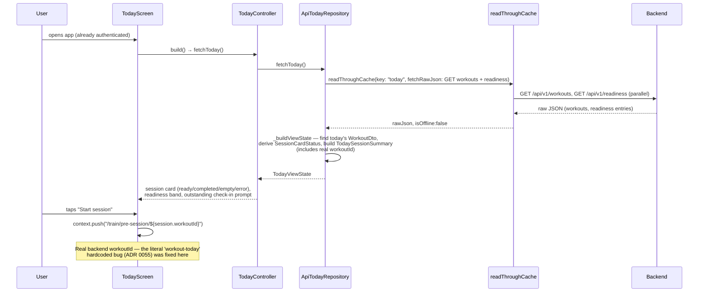
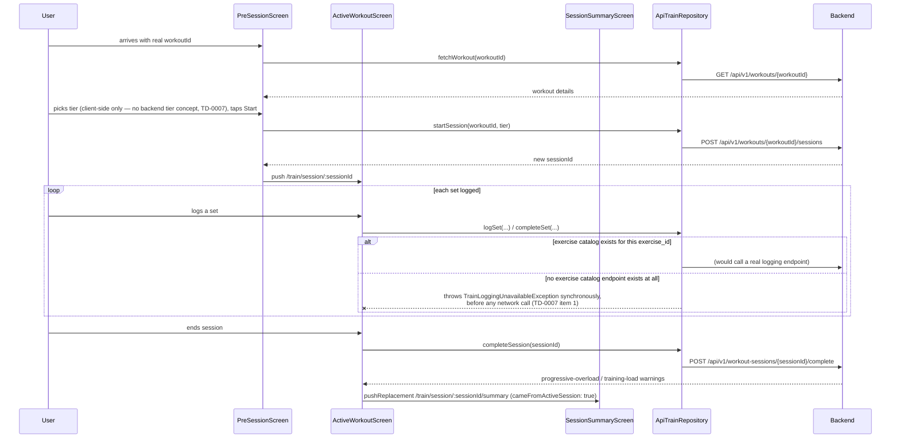
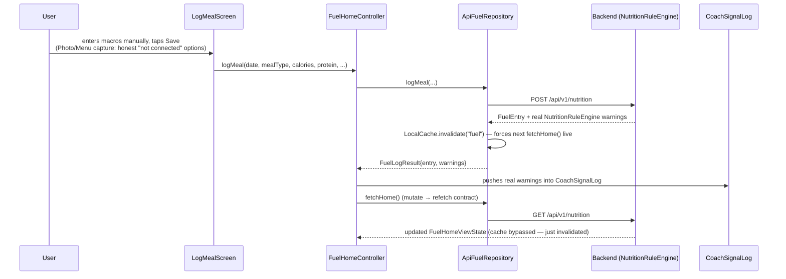
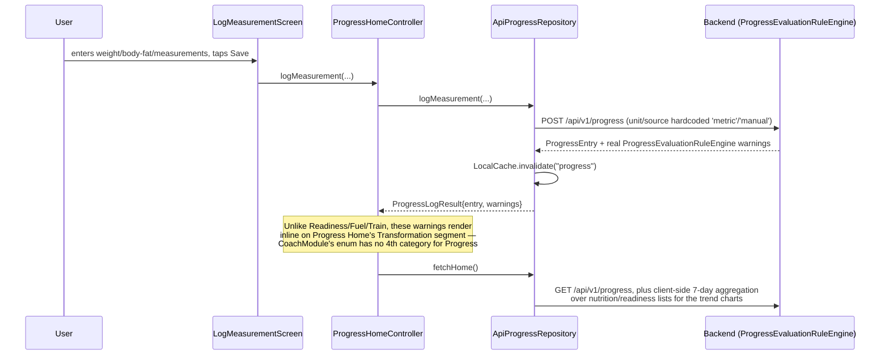
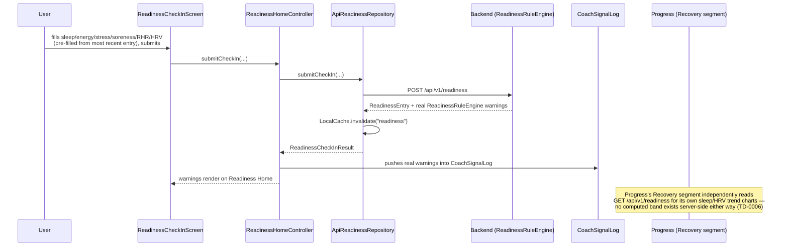
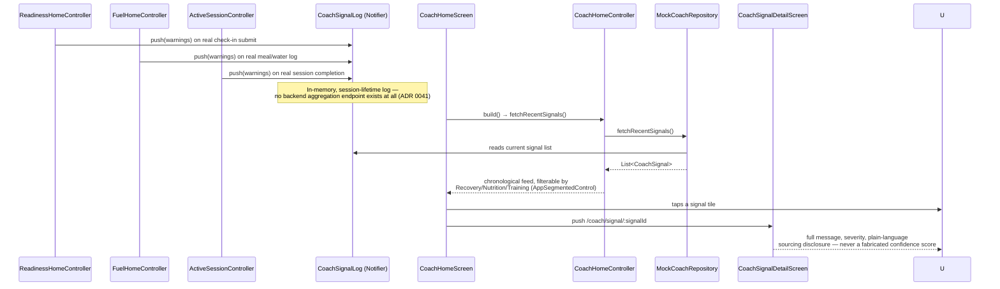

# Gym Companion — Architecture Overview

This document is onboarding-oriented: it exists so a new developer can understand how the
system fits together without reading all 55 ADRs first. It reflects the codebase as of the
final end-to-end integration audit (`docs/adr/0055-final-integration-audit.md`) — the
production-integration roadmap (`docs/adr/0042` through `0054`) is complete, and the app is
architecturally release-ready (real-device validation, `flutter analyze`/`flutter test`, and
release engineering remain, per `docs/adr/0002`'s standing "no Flutter SDK in this build
environment" constraint).

For the *why* behind any decision summarized here, the ADR index in Section 10 links to the
document that made it. For known, deliberately-deferred gaps, see `docs/TECH_DEBT.md`.

---

## 1. System overview

Gym Companion is a two-app monorepo: a FastAPI backend (`backend/`) implementing Clean
Architecture (Domain → Application → Infrastructure → API), and a Flutter mobile client
(`apps/mobile/`) implementing the same layering per feature (`domain/ → application/ →
infrastructure/ → presentation/`). The backend is the single source of truth for all business
logic — every rule engine (readiness, nutrition, progressive overload, safety, goal alignment,
training load, exercise recommendation) lives server-side; the Flutter client never
re-implements or fabricates business logic, only renders what the backend already computed
(`docs/adr/0045`'s "follow the backend exactly" convention, applied throughout Steps 3–6).

```
┌─────────────────────────┐        HTTPS / JSON        ┌──────────────────────────┐
│   apps/mobile (Flutter) │ ─────────────────────────▶ │   backend (FastAPI)      │
│   Riverpod + go_router  │ ◀───────────────────────── │   Domain/Application/    │
│                          │                             │   Infra/API layers       │
└─────────────────────────┘                             └──────────────────────────┘
        │                                                          │
        ▼                                                          ▼
  SharedPreferences                                          PostgreSQL
  (read-through cache,                                        (via SQLAlchemy +
   refresh token via                                           Alembic migrations)
   flutter_secure_storage)
```

Six user-facing feature modules exist on both sides, in the same order the bottom
navigation presents them: **Today, Train, Fuel, Progress, Readiness, Coach** (Readiness and
Coach have no 1:1 backend module of their own — Readiness is a real backend aggregate reached
from Today/Progress rather than a tab; Coach has **no backend concept at all** and is a
client-side aggregation of signals the other five features' own mutations already receive —
see Section 9's Coach flow and `docs/adr/0041`).

---

## 2. Repository layout

```
GYM/
├── backend/                     FastAPI backend — Clean Architecture, Python 3.10
│   ├── app/
│   │   ├── domain/              Aggregates + rule engines (zero framework deps)
│   │   ├── application/         Commands/Queries/Handlers — orchestration only
│   │   ├── infra/                SQLAlchemy models, repositories, UnitOfWork, security
│   │   ├── api/                  FastAPI routes/v1, schemas, deps, error handling
│   │   ├── composition/          Hand-rolled DI container, bootstrap, event dispatch
│   │   ├── ai/                   (present, currently unused — no AI/vision capability
│   │   │                          exists anywhere in this backend; see `docs/adr/0038`)
│   │   ├── jobs/
│   │   └── main.py               ASGI app entrypoint
│   ├── alembic/                  Migrations
│   └── tests/                    Mirrors app/ 1:1 (domain/application/infra/api/composition)
│
├── apps/mobile/                 Flutter client — Clean Architecture per feature
│   ├── lib/
│   │   ├── core/                 network/ (ApiClient, interceptors), cache/, mapping/
│   │   ├── design/               tokens/, theme/, components/ — the design system
│   │   ├── features/              today/ train/ fuel/ progress/ readiness/ coach/ auth/
│   │   │                          each: domain/ application/ infrastructure/ presentation/
│   │   ├── shared/                domain/application concepts genuinely shared across
│   │   │                          features (CoachSignal, CoachSignalLog, SessionTier)
│   │   ├── shell/                 app_router.dart (go_router), app_shell.dart (bottom nav)
│   │   ├── app.dart               MaterialApp.router root widget
│   │   └── main.dart              Composition root — every provider override lives here
│   └── test/                     Mirrors lib/ — unit, widget, flow, and accessibility tests
│
├── docs/
│   ├── adr/                      55 Architecture Decision Records (0001–0055)
│   ├── TECH_DEBT.md              14 tracked, deliberately-deferred items with triggers
│   └── Gym_Companion_*.docx      The six founding design documents (Product/Domain
│                                  Model/UX-UI/Engineering Master Plan/System Architecture
│                                  Bibles) — the specs every ADR traces decisions back to
│
├── infra/                        docker-compose.yml for local Postgres
├── scripts/                       Dev scripts (local Postgres bootstrap, migration safety check)
├── assets/, datasets/, models/   Scaffolded per `docs/adr/0001`, not yet populated — no
│                                  AI/ML component has been built (confirmed gap, `docs/adr/0038`)
└── tests/e2e/                    Scaffolded, not yet populated (blocked on real Flutter SDK
                                   + real backend deployment — same constraint as golden tests)
```

---

## 3. Feature boundaries

Both apps are organized **feature-first**, not layer-first at the top level — `lib/features/today/`
contains all of Today's own domain/application/infrastructure/presentation code, rather than
one global `domain/` folder holding every feature's models. Cross-feature reuse is deliberately
rare and, when it happens, goes through `lib/shared/` — confirmed during the final audit as the
one and only cross-feature coupling in the entire Flutter codebase (`quick_add_sheet.dart`
importing Fuel's `WaterLogSheet` directly, a disclosed exception — `docs/TECH_DEBT.md` TD-0005).

| Feature | Backend aggregate | Flutter tab | Real backend integration | Notes |
|---|---|---|---|---|
| **Today** | *(derives from Workout + Readiness)* | Yes (default landing tab) | `ApiTodayRepository` (ADR 0046) | No Habit/Streak or Task/Recommendation persistence exists server-side — those fields are always `null` (TD-0006) |
| **Train** | Workout, WorkoutSession | Yes | `ApiTrainRepository` (ADR 0048) | No exercise catalog or session-history-list endpoint exists (TD-0007); set logging is honestly disabled, not faked |
| **Fuel** | Nutrition | Yes | `ApiFuelRepository` (ADR 0049) | No AI/vision capability anywhere in the backend — manual entry is the one real path (ADR 0038) |
| **Progress** | Progress | Yes | `ApiProgressRepository` (ADR 0050) | Widest gap spread: Nutrition/Transformation are fully real, Workout/Reports are total placeholders |
| **Readiness** | Readiness | No (reached from Today/Progress) | `ApiReadinessRepository` (ADR 0047) | Real check-ins; computed readiness *band* has no backend source (TD-0006) |
| **Coach** | *none* | Yes | `MockCoachRepository`, **permanently** (ADR 0051) | Not a phase still pending — there is no backend Coach concept to integrate against; see Section 9 |
| **Auth** | User + Credential | *(gate, not a tab)* | `ApiAuthRepository` (ADR 0044) | The one module with no "mock until backend exists" era — built real from day one |

---

## 4. Provider graph (Riverpod)

Every Flutter feature follows the same provider shape: one `Provider<XRepository>` that
**throws `UnimplementedError` by default** — so a real implementation can never be forgotten
silently — overridden exactly once, in `main.dart`, the app's single composition root. Widget
tests override the same providers with their own fakes instead of touching `main.dart`.



**Notes on the graph:**

- `apiClientProvider` is built inside `main.dart`, not `lib/core/network/`, precisely because
  it needs closures reading `authControllerProvider` (`lib/core/network/` has zero imports of
  `lib/features/` — the dependency direction only exists at the composition root).
- `coachRepositoryProvider` is the one repository provider that is **not** a temporary mock —
  `MockCoachRepository` reads `coachSignalLogProvider`, which is genuinely populated by real,
  backend-sourced warnings pushed from Readiness/Fuel/Train's own controllers.
- `PreSessionController`/`ActiveSessionController` are `.family` providers keyed by
  `workoutId`/`sessionId` with **no `.autoDispose`** — a disclosed, open trade-off (TD-0011).
- Full provider list: `sharedPreferencesProvider`, `localCacheProvider`, `apiClientProvider`,
  `authRepositoryProvider`, `tokenStorageProvider`, `authControllerProvider`, `routerProvider`,
  and per feature — `{today,train,fuel,progress,readiness,coach}RepositoryProvider` plus each
  feature's own `AsyncNotifierProvider` (`todayControllerProvider`, `trainHomeControllerProvider`,
  `preSessionControllerProvider`/`activeSessionControllerProvider` (families), `fuelHomeControllerProvider`,
  `progressHomeControllerProvider`, `readinessHomeControllerProvider`, `coachHomeControllerProvider`),
  plus the shared `coachSignalLogProvider`.

---

## 5. Routing graph (go_router)

`routerProvider` is a `Provider<GoRouter>` (not a bare top-level `GoRouter`) specifically so its
`redirect` callback can read `authControllerProvider` — the one real architectural change Step 2
of production integration made (`docs/adr/0044`). Five tabs use `StatefulShellRoute.indexedStack`
so each keeps its own navigation stack; every drill-in screen is pushed onto the **root**
navigator (`parentNavigatorKey: _rootNavigatorKey`) so it renders full-screen, without the
bottom nav bar still tappable underneath it.



**Auth guard logic** (`_authRedirect` in `app_router.dart`): while `authControllerProvider` is
still resolving, every route redirects to `/splash` except `/splash` itself. Once resolved, an
unauthenticated session redirects anywhere-but-`/login`/`/register` to `/login`; an authenticated
session on `/login`, `/register`, or `/splash` redirects to `/today`. All 29 routes were verified
during the final audit to resolve to a real, existing screen with no orphans.

---

## 6. Repository architecture

Every feature declares its own `abstract interface class XRepository` inside its
**application** layer (not domain — the interface is a seam between presentation/application
and infrastructure, following Riverpod's own convention), with exactly two implementations:
`MockXRepository` (in-memory fixture, used by widget tests and — for Coach only — production)
and `ApiXRepository` (the real, HTTP-backed implementation, built during Step 3 of production
integration). Both were verified during the final audit to fully and consistently implement
their shared interface for all six features.

| Repository interface | Methods | Real implementation | Backend endpoint(s) |
|---|---|---|---|
| `TodayRepository` | `fetchToday()` | `ApiTodayRepository` | `GET /api/v1/workouts`, `GET /api/v1/readiness` |
| `TrainRepository` | `fetchHome()`, `fetchWorkout(id)`, `startSession(id, tier)`, `fetchSession(id)`, `logSet(...)`, `completeSet(...)`, `completeSession(id)` | `ApiTrainRepository` | `GET/POST /api/v1/workouts`, `GET /api/v1/workouts/{id}`, `POST /api/v1/workouts/{id}/cancel`, `POST .../sessions`, `GET /api/v1/workout-sessions/{id}`, `POST .../complete`, `POST .../sets/complete` |
| `FuelRepository` | `fetchHome()`, `logMeal(...)` | `ApiFuelRepository` | `GET/POST /api/v1/nutrition`, `PUT /api/v1/nutrition/{id}/water` |
| `ProgressRepository` | `fetchHome()`, `logMeasurement(...) → ProgressLogResult{entry, warnings}` | `ApiProgressRepository` | `GET/POST /api/v1/progress`, `PUT /api/v1/progress/{id}/body-composition`, `PUT .../measurements` |
| `ReadinessRepository` | `fetchHome()`, `submitCheckIn(...) → ReadinessCheckInResult` | `ApiReadinessRepository` | `GET/POST /api/v1/readiness`, `PUT /api/v1/readiness/{id}/sleep`, `PUT .../recovery-metrics` |
| `CoachRepository` | `fetchRecentSignals()` | `MockCoachRepository` (**permanent** — reads `coachSignalLogProvider`) | *none — no backend concept exists* |
| `AuthRepository` | `register(...)`, `login(...)`, `refresh(...)`, `logout()`, `currentUser()` | `ApiAuthRepository` | `POST /auth/register`, `/login`, `/refresh`, `/logout`, `GET /auth/me` |
| `TokenStorage` | `saveTokens(...)`, `readRefreshToken()`, `clear()` | `SecureTokenStorage` (Keychain/Keystore, via `flutter_secure_storage`) | *(local only)* |

On the backend, the equivalent split is **domain repository interfaces** (`app/domain/*/repository.py`,
one per aggregate — User, Workout, WorkoutSession, Exercise, Nutrition, Progress, Readiness, Goal)
implemented by SQLAlchemy-backed classes in `app/infra/repositories/`, resolved through the
hand-rolled DI container in `app/composition/container.py` and a per-request `UnitOfWork`
(`app/infra/unit_of_work.py`). Application-layer **handlers** (`app/application/*/handlers/`)
depend only on the domain repository interface, never the SQLAlchemy implementation directly —
the same "depend on the interface, not the implementation" discipline the Flutter side mirrors.

Every `GET` list endpoint in this backend returns the full, unpaginated collection — confirmed
no pagination concept exists anywhere in `backend/app/api/` — which is why `ApiClient.getList`
returns the decoded array directly rather than unwrapping a `results`/`items` envelope, and why
`ReadinessTimelineScreen`'s eager, unbounded list rendering is a tracked, open finding (TD-0010).

---

## 7. Networking layer (`apps/mobile/lib/core/network/`)

One shared `ApiClient` (built on `package:dio`) is constructed once, in `main.dart`, and passed
into every real `ApiXRepository`'s constructor. `package:dio` itself is never imported anywhere
outside `lib/core/network/` — every repository only ever calls `ApiClient.get`/`.getList`/
`.post`/`.patch`/`.delete`/`.postEmpty`, so a future HTTP client swap would touch one file.

**Interceptor chain** (registered in this order — retry before logging, so a retried request's
own log lines still appear):

1. **`AuthInterceptor`** — attaches `Authorization: Bearer <token>` to every outgoing request
   except the three calls marked `skipAuthHeader` (`login`/`register`/`refresh` themselves, which
   either have no token yet or carry the refresh token as their actual credential). On a `401`,
   it triggers exactly one refresh attempt; every other request that 401s *while that refresh is
   already in flight* awaits the same `Completer` rather than triggering a refresh storm. A
   refresh that itself fails calls `onRefreshFailed` (real logout) once, then lets the original
   401 propagate as a real `ApiException`.
2. **`RetryInterceptor`** — retries **GET-only**, **network-failure-only** (connection error or
   timeout — never a real 4xx/5xx response), up to `ApiConfig.maxRetries`, with a short increasing
   backoff. GET-only is a real safety constraint, not a style choice: this backend has no
   idempotency-key or dedup mechanism anywhere, so blindly retrying a POST/PATCH/DELETE risks a
   genuine double-mutation (e.g. two meals logged from one tap) with nothing on either end to
   detect it.
3. **`ApiLoggingInterceptor`** — debug-mode only (`kDebugMode`).

**Error mapping** (`ApiErrorMapper`) is the one place `DioException` is translated into this
app's own `ApiException` — every repository's catch block calls `ApiErrorMapper.map` and
rethrows the result; nothing outside `lib/core/network/` imports `package:dio` directly. Network-
level failures (timeout, connection error, or no response at all) set `isNetworkError: true`,
which is exactly the flag `readThroughCache` (Section 8) checks before falling back to a stale
cache entry rather than surfacing a raw error. A real backend response (any status code) is
never treated as a network error — its `detail` field (`str | list[str]` on the wire, per
`backend/app/api/schemas/common.py`'s `ErrorResponse`) is unwrapped into a single display string.

---

## 8. Caching layer (`apps/mobile/lib/core/cache/`)

Added in Step 4 of production integration (`docs/adr/0052`) as the supportable offline subset —
read-through caching and stale-while-revalidate for reads, **not** mutation retry queues,
conflict resolution, background sync, or offline writes (this backend has no idempotency-key or
synchronization concept to build any of those against safely).

- **`LocalCache`** — a thin `shared_preferences` wrapper. Every entry is one JSON envelope,
  `{"cachedAt": "<iso8601>", "data": <raw>}`, under a key namespaced `gym_companion_cache::`.
  `read`/`write`/`invalidate`/`clearAll` are its only four operations.
- **`readThroughCache<T>()`** — the one shared function every real `ApiXRepository`'s
  `fetchHome()`/`fetchToday()` calls, rather than five hand-rolled per-feature caching
  mechanisms. It caches **raw JSON**, not the parsed view state, so each repository's existing
  `XxxDto.fromJson`/`.toDomain()` parsing code stays the only place a view state is ever built —
  reused unchanged for both a live and a cached response.



A non-network `ApiException` (a real 4xx/5xx the server actually returned) is **never** masked
by a stale cache hit — it is always rethrown, so a genuine app-level error can't be silently
hidden behind old data. `kCacheFreshDuration` (5 minutes) is one shared constant across all five
cached repositories, not five different per-feature tunings.

**Mutation invalidation.** Every repository whose controller has a "mutate, then immediately
refetch" contract (`ReadinessHomeController.submitCheckIn`, `FuelHomeController.logMeal`/
`.logWater`, `ProgressHomeController.logMeasurement`) calls `LocalCache.invalidate(key)` on
success, so the immediate refetch is forced past the stale-while-revalidate fast path and shows
the real new data — a real regression Step 4's own review caught and fixed before it shipped
(`docs/adr/0052` Decision 6). Pull-to-refresh's own interaction with the 5-minute freshness
window is a *different*, disclosed, still-open trade-off (TD-0009) — a pull-to-refresh within
that window can still return a still-fresh cached value, with a real background revalidation
already in flight for the *next* read.

**Logout** clears every cached entry (`LocalCache.clearAll()`, called from
`AuthController._clearLocalSession`) — every cached entry is per-account data, so it must not
leak into the next person's very first frame on a shared device.

---

## 9. Authentication flow

`AuthController` (`AsyncNotifier<AuthState>`) is the single source of truth for "is anyone
signed in, and who" — `routerProvider`'s guard watches it directly via `ref.listen` inside a
`ChangeNotifier` bridge (`_GoRouterRefreshNotifier`), since `GoRouter`'s own `redirect` is
otherwise only re-evaluated on navigation, never on a provider changing underneath it.

- **Access token**: held only in memory (`AuthController._accessToken`), never persisted. Its
  short TTL (15 minutes, `backend/app/core/config.py`) means persisting it would save at most 15
  minutes of one skipped network call, at the real cost of a second secret on disk.
- **Refresh token**: the only secret `TokenStorage`/`SecureTokenStorage` ever writes — Keychain
  on iOS, Keystore-backed `EncryptedSharedPreferences` on Android.



**Background refresh-on-401** (independent of the flow above): `AuthInterceptor` calls
`AuthController.attemptRefresh()` the first time any request 401s mid-session; a failed
background refresh calls `AuthController.forceLogoutFromRefreshFailure()`, which clears local
state and lets the router redirect to `/login` on the next frame — see Section 7's interceptor
description for the concurrent-401 de-duplication behavior.

**Logout**: calls the real `POST /logout` (revokes the refresh token server-side) inside a
try/catch that's deliberately swallowed — a failed network call on logout must never trap the
user in a signed-in-looking state on their own device — then always clears local state and the
entire offline cache regardless of whether the server call succeeded.

---

## 10. Design system overview (`apps/mobile/lib/design/`)

Built before any feature screen existed (`docs/adr/0034`, refined in `docs/adr/0035`) as a
closed, hand-tuned system — no `ColorScheme.fromSeed`, no bundled font (native system fonts),
Material ripple disabled in favor of a token-driven pressed/hovered/focused opacity system.

- **`tokens/`** — the primitive values: `app_colors`, `app_typography`, `app_spacing`,
  `app_radius`, `app_elevation`, `app_motion`, `app_opacity`, `app_breakpoints`, `app_icons`.
- **`theme/`** — `AppColorScheme` (light + dark), `AppSemanticColors` (a `ThemeExtension` for
  success/warning/danger, since Material's own `ColorScheme` has no slot for them), `AppTextTheme`,
  and `AppTheme` (the memoized `ThemeData` factory `app.dart` builds `MaterialApp.router` on).
- **`components/`** — the closed allow-list every screen composes from: `AppButton`, `AppCard`,
  `AppBadge`, `AppListTile`, `AppSectionHeader`, `AppTextField`, `AppSegmentedControl`,
  `AppProgressBar`, `AppRatingSlider`, `AppLineChart`, `AppWeekHeatmap`, and the loading/empty/
  error primitives in `app_states.dart` (`AppSkeletonBox`, `AppEmptyState`, `AppErrorState`) plus
  bottom-sheet/confirmation-dialog helpers in `app_overlays.dart`.

A dedicated architecture review (`docs/adr/0035`) found and fixed every Critical/Important
finding: touch targets meet the 48dp minimum everywhere (with two later, narrower exceptions
tracked open — TD-0012, `ExerciseNav`'s own 40→48dp fix landed in the Step 5 audit), WCAG
contrast was computed (not asserted) with two real failures found and fixed, loading buttons
remain screen-reader accessible, and typography was audited under large accessibility text
sizes across every named component. `test/accessibility/guideline_test.dart` (Step 6) is the
first use of `flutter_test`'s `meetsGuideline` matchers, covering Today and Coach Home as a
representative — not yet exhaustive — sample (TD-0014).

---

## 11. Sequence diagrams — the six major user flows

### 11.1 Today — landing screen load, then "Start session"



### 11.2 Train — Pre-session → Active Workout → Session Summary



### 11.3 Fuel — logging a meal



### 11.4 Progress — logging a measurement



### 11.5 Readiness — submitting a check-in



### 11.6 Coach — the cross-module signal feed



---

## 12. ADR index

All 55 ADRs live in `docs/adr/`. Grouped here by phase for onboarding purposes — read them in
order within a phase for the full reasoning behind each decision.

**Foundations (0001–0004)**
0001 Repository layout · 0002 Flutter verification constraint (no SDK in this build
environment) · 0003 Riverpod, no codegen · 0004 Docker/Compose reviewed, not executed

**Backend Domain Layer — aggregates (0005–0012)**
0005 User · 0006 Workout · 0007 Exercise · 0008 WorkoutSession · 0009 ExercisePerformance/
ExerciseSet · 0010 Progress immutability policy · 0011 Nutrition per-entry log · 0012 Goal
lifecycle

**Backend Domain Layer — rule engines (0013–0021)**
0013 Rule Engine foundation · 0014 Readiness · 0015 Nutrition range thresholds · 0016 Goal
Alignment · 0017 Progressive Overload · 0018 Safety (cross-engine composition) · 0019 Progress
Evaluation · 0020 Training Load · 0021 Exercise Recommendation

**Backend Application Layer (0022–0028)**
0022 Foundation · 0023 User use cases · 0024 Workout use cases · 0025 Nutrition use cases ·
0026 Progress use cases · 0027 Readiness use cases · 0028 Goal use cases

**Backend Persistence, Composition, API, Auth (0029–0033)**
0029 Persistence Layer · 0030 Composition Root · 0031 FastAPI API Layer · 0032 Authentication &
Authorization · 0033 Resource Ownership Authorization

**Flutter Design System (0034–0035)**
0034 Design System foundation · 0035 Design System refinement

**Flutter Feature Modules — first build, mock-backed (0036–0041)**
0036 Today screen · 0037 Train module · 0038 Fuel module · 0039 Progress module · 0040
Readiness module · 0041 Coach module

**Production Integration roadmap (0042–0055)**
0042 Production integration plan (the roadmap itself) · 0043 Core networking layer (Step 1) ·
0044 Authentication module (Step 2) · 0045 Shared API mapping convention · 0046 Today
repository integration · 0047 Readiness repository integration · 0048 Train repository
integration · 0049 Fuel repository integration · 0050 Progress repository integration · 0051
Coach repository integration (confirmed no backend concept, permanent mock) · 0052 Offline
caching (Step 4) · 0053 Performance and accessibility audit (Step 5) · 0054 Testing and release
readiness (Step 6 — concludes the roadmap) · **0055 Final end-to-end integration audit** — the
read-only post-roadmap audit that found and fixed the one genuine correctness bug described in
Section 11.1's Today flow diagram.

---

## 13. Known limitations (see `docs/TECH_DEBT.md` for full detail)

14 tracked items (TD-0001 through TD-0014) as of ADR 0055; TD-0001 and TD-0002 (backend
duplication and ownership-authorization gaps) are **resolved**. Open items relevant to a new
developer: no exercise catalog or session-history-list endpoint exists server-side (TD-0007);
`ReadinessTimelineScreen` renders its full unpaginated history eagerly, not lazily (TD-0010);
Train's per-workout/session providers have no `.autoDispose` (TD-0011); `LoggedSetRow`'s tap
target is likely under 48dp (TD-0012); three forms lack keyboard focus chaining (TD-0013); and
accessibility guideline tests currently cover 2 of ~24 screens (TD-0014). None of these block
onboarding — each has a concrete trigger condition for when to act on it.

**What remains before release**, per ADR 0054/0055: real-device validation, `flutter analyze`/
`flutter test` (no Flutter SDK exists in this build environment — every line of Flutter code in
this repo has been hand-authored and statically/structurally verified, never executed, per ADR
0002), `android`/`ios` platform folder generation, golden tests, a real TalkBack/VoiceOver pass,
app icon/splash/store metadata, and store submission.
