# Aura Engine

A real-time, gesture-driven creative platform: hand tracking, computer
vision, a PixiJS/Matter.js rendering & physics runtime, and a pluggable
experience framework, running entirely client-side at 60 FPS. **Flower
Garden** — bloom flowers from your fingertips, grow plants by holding a
fist still, and throw a bouquet with a pinch — is its first experience;
the architecture is built to host more (Galaxy, Fireworks, Snow, Air
Painter, Bubble World, Magic Wand, ...) without touching the engine.

> Formerly "Flower Wand++." Renamed once the project outgrew being about
> one effect — see [Project rename](#project-rename) at the end of this
> README.

## Status

**Phase 5 of 10 — Effects & Experiences — complete.** Phase 6 (Themes & Assets) is next. See [Build Phases](#build-phases) below.

## Tech Stack

- **Frontend:** React 19, Vite, TypeScript (strict), Tailwind CSS v4
- **Computer Vision:** MediaPipe Tasks Vision (Hand Landmarker, Face Landmarker)
- **Graphics:** PixiJS, Matter.js, GSAP
- **Utilities:** Framer Motion, Zustand, React Icons
- **Testing:** Vitest + jsdom
- **Deployment:** Vercel (auto preview/production deploys) + GitHub Actions CI — see [Deployment](#deployment)

## Getting Started

```bash
npm install
npm run dev          # start the dev server (http://localhost:5173)
npm run build        # type-check + production build
npm run preview      # preview the production build locally
npm run lint          # ESLint (zero warnings enforced)
npm run format        # Prettier write
npm run typecheck     # TypeScript project-wide check, no emit
npm run test           # Vitest, single run
npm run test:watch     # Vitest, watch mode
```

Press **`` ` ``** (backtick) anywhere in the app to toggle the debug HUD.

## Deployment

Production deployment is Vercel + GitHub Actions, layered onto the
existing project rather than a new roadmap phase — CI enforces the same
four checks locally available as npm scripts, and Vercel's own Git
integration (not a custom deploy script) handles preview/production
hosting. Nothing about the app's architecture changed to support this;
it's a static Vite build with no server, no API routes, and (today) no
environment variables.

### One-time setup

1. **Push this repository to GitHub.** It's already a local git repo
   (`git init` was run as part of this setup, with a first commit — see
   below); create an empty repository on GitHub, then:
   ```bash
   git remote add origin https://github.com/<you>/<repo>.git
   git push -u origin main
   ```
2. **Import the repository into Vercel.** In the Vercel dashboard:
   New Project → import the GitHub repo → Vercel auto-detects the
   "Vite" framework preset from `vercel.json`. No manual build-command
   configuration is needed; `vercel.json` already pins
   `installCommand`/`buildCommand`/`outputDirectory` explicitly so the
   build behaves identically whether it runs locally, in GitHub Actions,
   or on Vercel.
3. **(Optional) Require CI to pass before merging.** In the GitHub repo's
   Settings → Branches → branch protection rule for `main`, add
   "Typecheck, Lint, Test, Build" (the CI job name — see below) as a
   required status check. This is what actually gates what lands on
   `main`; Vercel deploying and GitHub Actions running CI are two
   independent triggers on the same push otherwise.

That's it — no deploy tokens, no secrets, no custom GitHub Action for
shipping to Vercel. Everything past this point is automatic.

### What happens on every push

- **GitHub Actions** (`.github/workflows/ci.yml`) runs on every push to
  `main` and every pull request: `npm ci`, then `typecheck`, `lint`,
  `test`, `build` as four sequential steps in one job, using the Node
  version pinned in `package.json`'s `engines.node` field (matching
  Vite 8's own requirement). Superseded runs on the same branch/PR are
  cancelled automatically so pushing twice in a row doesn't double up.
- **Vercel** deploys independently, via its native GitHub integration
  (no GitHub Actions step required for this): every push to a
  non-`main` branch or open pull request gets its own **preview
  deployment** with a unique URL, posted as a PR check/comment; every
  push to `main` deploys to **production**. `vercel.json`'s `rewrites`
  rule falls back every path to `index.html` — harmless today (the app
  is a single route) and a safety net if client-side routing is ever
  added later.

### `vercel.json`

```json
{
  "framework": "vite",
  "installCommand": "npm ci",
  "buildCommand": "npm run build",
  "outputDirectory": "dist",
  "rewrites": [{ "source": "/(.*)", "destination": "/index.html" }]
}
```

### Environment variables

None are required today — the app is 100% client-side (camera access,
MediaPipe WASM, PixiJS/Matter.js all run in-browser) with no API keys or
backend services. If a future phase adds one (e.g. an analytics or audio
CDN key), add it as `VITE_`-prefixed (Vite only exposes prefixed vars to
client code) in Vercel's Project Settings → Environment Variables, and
mirror it in a local, gitignored `.env.local` for `npm run dev` — see
`.gitignore`'s "Environment variables" block.

### Local production preview

```bash
npm run build && npm run preview   # serves the exact dist/ Vercel would deploy
npx vercel dev                     # optional: full Vercel CLI emulation, if the Vercel CLI is installed
```

## Architecture

The app is split into two layers that don't know about each other's internals:

- **Engine layer** (`src/engine/`) — a framework-free real-time core. `Engine`
  composes nine independently-testable managers and ticks whichever
  `ISystem` instances have registered with it. Systems never call each other
  directly; they communicate over `engine.eventBus`.
- **React layer** — UI only. Components read discrete state through hooks;
  nothing that changes every frame is allowed to live in `useState`. The
  debug HUD is painted straight into the DOM from an event bus subscription,
  bypassing React's render cycle entirely.

### The nine core managers (built during the Camera System phase)

| Manager                 | Responsibility                                                                                                  |
| ----------------------- | --------------------------------------------------------------------------------------------------------------- |
| `SystemRegistry`        | Owns the `ISystem` map — register/unregister/lookup, extracted out of `Engine` itself                           |
| `TimeManager`           | Delta/elapsed time, `pause()`/`resume()`, `timeScale` (slow-mo), independent of _when_ frames happen            |
| `Scheduler`             | Frame-driven one-shot/interval tasks (`scheduleOnce`/`scheduleInterval`), paced by `TimeManager`'s scaled delta |
| `PerformanceMonitor`    | Whole-frame FPS / frame time / memory (existing, Phase 2)                                                       |
| `PerformanceProfiler`   | Named `begin`/`end` marks with rolling min/max/avg — per-operation timing (e.g. future `vision.inference`)      |
| `LogManager` / `Logger` | Scoped, leveled logging with pluggable sinks (console + event bus) — replaces raw `console.*` calls             |
| `ConfigManager`         | Typed, named config sections (`register`/`get`/`update`/`subscribe`) — ready for a future Settings UI           |
| `AssetManager`          | Preload/cache/lazy-load registry with pluggable loaders and in-flight dedup                                     |
| `PluginManager`         | Generic register/enable/disable lifecycle for plugins — reused later for particle emitter plugins               |
| `DebugManager`          | Visibility flag + pluggable debug sections; each system describes itself, the HUD just renders whatever exists  |

Every manager is a plain class with no React or DOM dependency (`RenderLoop`
and asset loaders are the two exceptions that must touch browser APIs, and
even those isolate it to one small file), constructed once by `Engine` and
handed to every system via `EngineContext` — dependency injection throughout,
no module-level singletons.

### Architecture diagram

```mermaid
flowchart TB
    subgraph React["React Layer (UI only)"]
        HomePage["HomePage / AppShell"]
        CameraView["CameraView, CameraFeed, ..."]
        DebugOverlay["DebugOverlay"]
        useCamera["useCamera / useDebugVisibility hooks"]
    end

    subgraph EngineCore["Engine (src/engine/Engine.ts)"]
        RenderLoop["RenderLoop\n(raw rAF delta)"]
        TimeManager["TimeManager\n(scaled delta/elapsed, pause, timeScale)"]
        SystemRegistry["SystemRegistry"]
        Scheduler["Scheduler\n(once/interval tasks)"]
        EventBus["EventBus&lt;EngineEventMap&gt;"]
        PerfMon["PerformanceMonitor"]
        PerfProfiler["PerformanceProfiler"]
        LogManager["LogManager / Logger"]
        ConfigManager["ConfigManager&lt;AppConfigMap&gt;\n(camera, vision, gesture, rendering,\nphysics, particles, experience, flowerGarden)"]
        AssetManager["AssetManager"]
        PluginManager["PluginManager"]
        DebugManager["DebugManager\n(camera, vision, gesture,\nrender, physics, experience)"]
    end

    subgraph Systems["ISystem implementations — ticked in this order each frame"]
        CameraSystem["CameraSystem\n(Phase 2)"]
        VisionSystem["VisionSystem\n(Phase 3)"]
        PhysicsSystem["PhysicsSystem\n(Phase 4)"]
        EffectsSystem["EffectsSystem\n(Phase 4)"]
        RenderSystem["RenderSystem\n(Phase 4)"]
    end

    subgraph VisionGesture["Vision & Gesture subsystem (framework-free, no rendering)"]
        VisionPipeline["VisionPipeline\n(owns hidden &lt;video&gt;)"]
        GestureEngine["GestureEngine"]
        Classifiers["10 gesture classifiers"]
        StateMachine["GestureStateMachine\n(one per hand + 'both')"]
    end

    subgraph ExperienceCore["experience/ (framework-free)"]
        ExperienceManager["ExperienceManager\n(gesture map + hold/release\ntracking + IExperience registry)"]
        EffectManager["EffectManager\n(active IEffect lifecycle)"]
        PlaceholderEffect["PlaceholderBurstEffect\n(Phase 4 placeholder, still registered)"]
        FlowerGarden["FlowerGardenExperience\n(IExperience, Phase 5)"]
        SixEffects["6 effects: FlowerBloom, MagicDust,\nButterfly, FingerTrail,\nPlantGrowth, Bouquet"]
    end

    subgraph ParticlesCore["particles/ (framework-free, no Matter.js)"]
        ParticleEngine["ParticleEngine\n(lightweight Euler integration)"]
        ParticlePool["ParticlePool\n(fixed-size, pre-allocated)"]
        Emitter["Emitter\n(spawn-rate accumulator)"]
    end

    subgraph PhysicsCore["physics/ (only file importing matter-js)"]
        PhysicsWorld["PhysicsWorld\n(bodies, constraints, collisions)"]
        Wind["Wind.ts\n(pure force helper)"]
    end

    subgraph RenderingCore["rendering/ (PixiJS primitives)"]
        SceneGraph["SceneGraph + RenderLayers"]
        Camera2D["Camera\n(pan/zoom/rotate)"]
        TextureManager["TextureManager"]
        SpriteManager["SpriteManager\n(pooled sprites)"]
        IRenderer["IRenderer / PixiRenderer\n(only file importing PIXI.Application)"]
    end

    subgraph Services["services/ (framework-free, DI-tested)"]
        CameraService["CameraService\n(getUserMedia wrapper)"]
    end

    RenderLoop -- "rawDeltaMs" --> EngineCore
    EngineCore -- "update(dt, elapsed)" --> Systems
    TimeManager --> Scheduler
    Scheduler -- "debug:snapshot @ 250ms" --> EventBus

    CameraSystem --> CameraService
    CameraSystem -- "camera:* events" --> EventBus
    EventBus -- "camera:stream-ready" --> VisionSystem
    VisionSystem --> VisionPipeline
    VisionPipeline --> GestureEngine
    GestureEngine --> Classifiers
    GestureEngine --> StateMachine
    VisionSystem -- "vision:frame" --> EventBus
    VisionSystem -- "gesture:transition" --> EventBus

    EventBus -- "gesture:transition" --> EffectsSystem
    EventBus -- "vision:frame (hand position)" --> EffectsSystem
    EffectsSystem --> ExperienceManager
    ExperienceManager --> EffectManager
    EffectManager --> PlaceholderEffect
    EffectManager --> SixEffects
    ExperienceManager -- "activateExperience('flower-garden')" --> FlowerGarden
    FlowerGarden -- "registerEffects()" --> EffectManager
    FlowerGarden -- "ambient update(): butterfly spawn,\nfinger trail emission" --> EffectManager
    EventBus -- "vision:frame (fingertip positions)" --> EffectsSystem
    PlaceholderEffect -- "burst()" --> ParticleEngine
    SixEffects -- "burst() / acquireManualParticle()" --> ParticleEngine
    ParticleEngine --> ParticlePool
    ParticleEngine --> Emitter
    ConfigManager -. "shared gravity/wind config" .-> ParticleEngine
    EffectsSystem -- "particles:frame" --> EventBus

    EffectsSystem --> ThemeCoordinator
    ThemeCoordinator --> ThemeManager
    ThemeCoordinator --> AssetPackManager
    ThemeManager --> SixThemes
    AssetPackManager -- "load/release(key)" --> TextureManager
    ThemeCoordinator -- "getActiveTheme()" --> FlowerGarden
    ConfigManager -- "subscribe('theme')" --> EffectsSystem

    PhysicsSystem --> PhysicsWorld
    PhysicsWorld --> Wind
    PhysicsWorld -- "physics:collision" --> PhysicsSystem
    PhysicsSystem -- "physics:collision" --> EventBus
    ConfigManager -- "subscribe('physics')" --> PhysicsSystem

    EventBus -- "particles:frame" --> RenderSystem
    RenderSystem --> SceneGraph
    RenderSystem --> Camera2D
    RenderSystem --> TextureManager
    RenderSystem --> SpriteManager
    RenderSystem --> IRenderer
    RenderSystem -- "render:ready" --> EventBus

    Systems -- "registerSection(...)" --> DebugManager
    EventBus -- "debug:snapshot" --> DebugOverlay
    EventBus -- "camera:*" --> useCamera
    useCamera --> CameraView
    CameraView --> HomePage
    DebugOverlay --> HomePage

    PerfMon --> DebugManager
    SystemRegistry --> DebugManager
```



Every future system (Audio, Recording, ...) plugs into the same seam
already established: an `ISystem` registered in `createAppEngine.ts`
talking over `engine.eventBus`. Every future *experience* (Galaxy,
Fireworks, Snow, Air Painter, Bubble World, Magic Wand, ...) plugs into
the seam Phase 5 added: one class satisfying `IExperience`, registered
with `ExperienceManager.registerExperience` and switched to via
`activateExperience(id)` — see
[Interactive Experiences subsystem](#interactive-experiences-subsystem-phase-5)
below. Nothing about `Engine`, `RenderSystem`, `EffectManager`, or
`ExperienceManager` itself needs to change to add either kind.

### Vision & Gesture subsystem (Phase 3)

Strict one-way data flow, matching the required architecture:

```
Camera → VisionSystem → VisionPipeline → GestureEngine → EventBus → Future Systems
```

- **`VisionPipeline`** (`src/vision/`) owns its own hidden `<video>` element
  attached to the same `MediaStream` `CameraSystem` broadcasts — a second,
  independent consumer of the stream alongside the visible preview `<video>`
  React renders. Each `detect()` call runs the injected hand/face landmarker
  adapters, filters results below the configured confidence thresholds, and
  smooths surviving landmarks through a per-hand/per-face `LandmarkSmoother`
  (EMA). Zero MediaPipe imports outside `vision/adapters/` — everything else
  depends on `IHandLandmarkerAdapter` / `IFaceLandmarkerAdapter`.
- **`GestureEngine`** (`src/gestures/`) runs every detected hand through all
  10 classifiers, keeps the highest-confidence match, and drives one
  `GestureStateMachine` per hand identity (`'Left'` / `'Right'`, plus a
  synthetic `'both'` for two-hand gestures). Adding an 11th gesture touches
  exactly two files: a `GestureType` literal and one classifier class —
  `GestureEngine` and `GestureStateMachine` never change.
- **`GestureStateMachine`** turns noisy per-frame classifier output into a
  stable `current` gesture via debounce (must hold N ms) + cooldown (no
  flicker between transitions), using flat early-return guard clauses
  instead of nested `if`s, and keeps a bounded rolling history.
- **`VisionSystem`** (`src/engine/systems/`) is the only file that wires
  this subsystem onto the Engine: it lazily loads the MediaPipe WASM
  runtime + both models on the first `camera:stream-ready` event (never
  pays that cost if the user never grants camera access), runs one
  `detect()` + `GestureEngine.update()` pass per tick — throttled by
  `vision.minInferenceIntervalMs` — and forwards results as `vision:frame`
  / `gesture:transition` on `engine.eventBus`. It never touches rendering.

### Rendering & Physics subsystem (Phase 4)

The required pipeline, implemented as described in the phase spec:

```
VisionSystem → Gesture Events → ExperienceManager → EffectManager → ParticleEngine → PhysicsEngine → PixiJS Renderer
```

- **`RenderSystem`** (`src/engine/systems/`) is the only file that touches
  `PIXI.Application` — through the `IRenderer` DI seam (`PixiRenderer` is
  the real implementation). It owns `SceneGraph` (a root `Container` plus
  five fixed, ordered `RenderLayers` — `background`/`world`/`particles`/
  `foreground`/`debug` — so z-order is decided once, not scattered across
  call sites), a 2D `Camera` (pan/zoom/rotate via pivot+position+scale),
  and `TextureManager`/`SpriteManager` (cache + object pool respectively).
  Every tick it reconciles pooled sprites against the latest
  `particles:frame` snapshot and calls `renderer.render()` manually — the
  Engine's own `RenderLoop` stays the single source of frame timing;
  PixiJS's own auto-ticker is disabled.
- **`PhysicsSystem`** (`src/engine/systems/`) adapts `PhysicsWorld` — the
  single file importing `matter-js` — to `ISystem`: steps the simulation
  each tick, forwards Matter.js collisions as `physics:collision`, and
  exposes body/constraint creation (circle/rectangle bodies, spring/pin
  constraints, configurable gravity, and a custom directional-with-gusts
  `Wind` force Matter.js has no native concept of). Fully built and tested
  this phase; not yet consumed by any effect — see trade-offs below.
- **`EffectsSystem`** (`src/engine/systems/`) is the integration point: it
  correlates the independent `gesture:transition` (identity, no position)
  and `vision:frame` (positions, no gesture identity) event streams into
  one `{gesture, handId, x, y, timestampMs}` context, hands it to
  `ExperienceManager` (maps a stable gesture to a registered effect id via
  the configurable `gestureEffectMap`), which triggers it through
  `EffectManager` (registry + lifecycle of active `IEffect` instances).
  Every tick it also advances `ParticleEngine` and emits the resulting
  particle swarm as `particles:frame` for `RenderSystem` to draw — the
  entire coupling between "what happened" and "what's drawn" is that one
  event.
- **`ParticleEngine`** (`src/particles/`) owns a fixed-size `ParticlePool`
  (pre-allocated once, never grown — the "object reuse" requirement) and
  any number of `Emitter`s (continuous spawn-rate accumulators). Particles
  integrate their own lightweight velocity + gravity/wind each tick rather
  than running through `PhysicsWorld`/Matter.js — see trade-offs.
- **`PlaceholderBurstEffect`** (`src/experience/effects/`) is the Phase 4
  placeholder — an unthemed, tinted-dot particle burst — still registered
  today as a harmless fallback effect, superseded as the active mapping
  by Flower Garden.

### Interactive Experiences subsystem (Phase 5)

The first complete, polished experience built on top of the Phase 4
runtime, plus the extensibility seam that makes it swappable rather than
hardcoded:

```
VisionSystem (fingertips + wrist) → Gesture Events → ExperienceManager
   (gestureEffectMap / gestureReleaseEffectMap / gestureHoldEffectMap)
   → EffectManager → 6 IEffects → ParticleEngine → RenderSystem
```

- **`IExperience`** (`src/experience/IExperience.ts`) is the new
  extensibility contract this phase adds: `id`, a `config`
  (`ExperienceRuntimeConfig`) it installs while active, `registerEffects()`
  (called once on activation), and `update()` for ambient, non-gesture
  behavior. `ExperienceManager.registerExperience(id, factory)` +
  `activateExperience(id)` are the only two new public methods on
  `ExperienceManager` — everything from Phase 4
  (`handleGestureTransition`, `updateConfig`) is unchanged and still
  fully backward compatible. Adding "Galaxy" later means writing one
  `IExperience` class and one `registerExperience` call in
  `EffectsSystem.init()` — never touching `ExperienceManager`,
  `EffectManager`, `EffectsSystem`, or `ParticleEngine`.
- **Three gesture-effect maps, not one.** Phase 4's `gestureEffectMap`
  (instant, on transition-in) is joined by two new *optional* maps on
  `ExperienceRuntimeConfig`: `gestureReleaseEffectMap` (fires when a hand
  transitions *away* from a mapped gesture, with `holdDurationMs` — how
  Bouquet knows how long a pinch was held) and `gestureHoldEffectMap`
  (fires once a gesture has been held continuously past a threshold,
  checked every ambient tick rather than at a transition boundary, since
  "still holding" has no transition event of its own — how Plant Growth
  gates on a held closed fist). Both are computed purely from the same
  `gesture:transition` events `ExperienceManager` already received in
  Phase 4; no new EventBus event type was needed.
- **`FlowerGardenExperience`** (`src/experience/effects/flowerGarden/`)
  wires the gesture maps above to real effect ids
  (`open-hand → flower-bloom`, `pinch release → bouquet`,
  `closed-fist held ≥ 1.2s → plant-growth`), registers all six effects
  below with `EffectManager`, and owns two purely ambient behaviors in its
  own `update()`: occasional butterfly spawning (respecting
  `maxConcurrent`) and throttled, interpolated finger-trail emission per
  tracked hand — neither gesture-triggered.
- **Six `IEffect`s**, every one pool-backed and reusing exactly the Phase 4
  particle/pool/emitter machinery, no bespoke rendering path:
  - **`FlowerBloomEffect`** blooms one flower particle per tracked
    fingertip (falling back to the single trigger position), each with a
    configurable scale-in "bloom" animation, small initial pop of
    speed/rotation for natural non-uniform placement, buoyancy so it
    floats rather than falls, wind influence, a random texture/tint from
    a small placeholder palette, and the shared automatic fade-out —
    then triggers `MagicDustEffect` around itself.
  - **`MagicDustEffect`** spawns motes that *orbit* a point (usually a
    bloom) using `Particle`'s new `orbitCenter/Radius/AngularSpeed`
    fields, drifting slightly with wind, fading over a short lifetime.
    Both directly triggerable (registered like every other effect) and
    triggered automatically by every bloom.
  - **`ButterflyEffect`** is one butterfly's full lifecycle as a single
    *manually-driven* particle (`ParticleEngine.acquireManualParticle` /
    `setManualParticleTransform`) — a small
    wandering → traveling-to-land → landed → flying-away state machine
    with clamped seek-and-arrive movement, a perpendicular sine wobble
    for organic (non-robotic) flight, and rotation/flutter-scale synced
    to its heading — spawned occasionally by `FlowerGardenExperience`'s
    ambient timer, not by a gesture.
  - **`FingerTrailEffect`** spawns a short-lived pooled burst — randomly
    one of three visual variants (glow/sparkle/petal) — at every point in
    an already-interpolated set of path points, so a fast-moving finger
    doesn't leave gaps; the interpolation itself lives in
    `FlowerGardenExperience`, not the effect.
  - **`PlantGrowthEffect`** is a seed → stem → leaves state machine on
    one manually-driven particle (texture swapped, scale eased in per
    stage), triggered by `gestureHoldEffectMap`'s closed-fist threshold;
    the final stage releases its particle and hands off to
    `FlowerBloomEffect` at the same spot rather than reimplementing a
    bloom animation.
  - **`BouquetEffect`** explodes an evenly-distributed, palette-varied
    burst of flower-tinted particles from the pinch-release position,
    sized linearly between `minParticles` (instant tap) and
    `maxParticles` (held ≥ `fullHoldMs`) from `holdDurationMs`.
- **`EffectsSystem`** extends its Phase 4 wrist-only position tracking
  with a second map, all five fingertip positions per hand
  (`getFingertipPositions()`), scaled into render-viewport pixels exactly
  like the wrist was — injected into `FlowerGardenExperience` and
  `FlowerBloomEffect` as plain accessor functions (the same DI pattern
  every other cross-boundary dependency in this codebase uses). It also
  now ticks `ExperienceManager.update(deltaMs, nowMs)` every frame, using
  `performance.now()` by default — the same wall-clock `VisionSystem`
  stamps `gesture:transition.timestampMs` with — so hold-duration math
  compares against a consistent clock.
- **`AssetManager`-ready placeholder assets.** Every effect references
  textures purely by logical string key (`'flower-garden/flower-1'`,
  `'flower-garden/butterfly'`, ...) — no file paths, no inline art. As of
  Phase 6, every one of those keys is now supplied by whichever theme is
  active rather than hardcoded per effect — see
  [Theme & Asset subsystem](#theme--asset-subsystem-phase-6) below.

### Theme & Asset subsystem (Phase 6)

Themes and asset packs as first-class, swappable infrastructure on top
of the Phase 5 runtime — every Flower Garden effect now reads its
texture keys and tints from an injected theme rather than a hardcoded
constant, so switching themes touches zero effect code:

```
ConfigManager('theme') → EffectsSystem → ThemeCoordinator
   → ThemeManager (which theme, blended config)
   → AssetPackManager (which textures are loaded)
   → FlowerGardenExperience.getTheme() → 6 IEffects
```

- **`ThemeManager`** (`src/themes/`) is a registry + inheritance resolver
  + transition engine for `ThemeDefinition`s. `registerTheme()` eagerly
  resolves a theme's full `extends` chain (via `deepMergeThemeField`,
  which recurses into nested plain objects like `assets.trailTextureKeys`
  but replaces arrays/primitives wholesale) at registration time, not
  lazily at read time — a theme with an unregistered `extends` parent
  fails immediately, and as a structural side effect a genuine
  inheritance cycle can never be constructed (you can't register the
  first half of one, since its parent doesn't exist yet). `setActiveTheme()`
  snaps instantly on first activation and animates continuous fields
  (colors via channel-wise RGB `lerpColor`, lighting, gravity) over
  `transitionMs` on every activation after that, while discrete fields
  (texture keys, asset pack id, sounds) snap to the target immediately —
  cross-fading a texture swap would need real compositing, out of scope
  this phase. Re-switching mid-transition blends onward from the
  *current* blended state, not the original starting theme.
- **`AssetPackManager`** (`src/assets/`) loads, caches, versions, and
  cleans up named `AssetPackDefinition`s directly on top of
  `TextureManager` (Phase 4) rather than the Engine's generic
  `AssetManager` — the same reasoning `TextureManager` itself already
  documents for bypassing `AssetManager` (GPU `.destroy()` on disposal,
  no URL loader for procedural textures) applies again here.
  `preloadPack()` is a no-op if the pack is already loaded at its current
  registered `version` ("avoid duplicate asset loading"); a version bump
  evicts and reloads every texture the pack owns. `retainPack`/
  `releasePack` are refcounted, so two themes that share one
  `assetPackId` (Garden and Winter) don't fight over its lifetime when
  switching between them. Texture atlases slice one loaded sheet into
  named sub-textures via PixiJS's `Texture`/`Rectangle` constructors,
  registered back into `TextureManager.getOrCreate()` — no new
  `TextureManager` capability needed beyond the one addition below.
- **`TextureManager.release(key)`** (Phase 4 class, one Phase 6 addition)
  is the per-key counterpart to its existing clear-everything `dispose()`
  — destroys and evicts a single cached texture, which is what
  `AssetPackManager` needs for versioned/refcounted cleanup without
  tearing down every other texture in the app.
- **`ThemeCoordinator`** (`src/themes/`) composes `ThemeManager` +
  `AssetPackManager` into the one entry point `EffectsSystem` actually
  talks to. `switchTheme(id)` ensures the target pack is loaded, then
  activates the theme's config, then releases the previous theme's pack
  (skipped if the two themes share one) — in that order, so a switch
  never shows a flash of missing textures. Critically, a failed pack load
  (a 404 on a placeholder URL with no real art yet) is caught and
  reported via an injectable `onPackLoadError` hook rather than
  propagating — it must never block the theme's *config* (colors,
  physics, wind, lighting, none of which depend on textures) from
  activating. A second, additive method, `bootstrapActiveTheme(id)`,
  activates the boot theme's config synchronously and kicks off its pack
  load in the background unawaited — `EffectsSystem.init()` must return
  synchronously (no GPU work, unlike `RenderSystem`), and a gesture
  arriving in the very same tick already needs a valid
  `getActiveTheme()` to read.
- **Six production themes** (`src/themes/definitions/`) — Garden
  (default/root), Sakura, Galaxy, Ocean, Cyberpunk (each a full,
  standalone `ThemeDefinition` + paired `AssetPackDefinition`), and
  Winter, which `extends: 'garden'` and deliberately registers *no*
  asset pack of its own — it inherits Garden's texture keys and reuses
  Garden's pack entirely, overriding only `colors`/`lighting`/
  `physicsOverrides`/one `sounds` field. A real "recolor an existing
  theme without new art" use case, not an artificial inheritance
  relationship invented just to exercise the feature. Every theme
  defines background/flower/butterfly/particle texture keys, a full tint
  palette, ambient lighting, wind/gravity physics overrides, and
  placeholder sound-effect references (no audio playback until Phase 8).
- **Every Flower Garden effect is now theme-driven.** The same
  dependency-injection pattern already used for `getConfig` gained a
  parallel `getTheme: () => ResolvedTheme` callback on each effect's
  dependencies interface, read at `trigger()` time — not threaded
  through `EffectTriggerContext`, which would have coupled the generic
  gesture-dispatch path in `ExperienceManager` to Flower-Garden-specific
  theme concerns. `ButterflyEffect` and `PlantGrowthEffect` read the
  theme once at trigger time and don't re-skin an already-spawned
  butterfly or an in-progress growth sequence mid-animation if the theme
  changes underneath them — a documented, intentional trade-off.
  `BouquetEffect` deliberately reuses `FlowerBloomEffect`'s
  `flowerTextureKeys`/`flowerTints` rather than the theme carrying a
  separate bouquet-specific palette, since a bouquet is just many blooms
  at once. `FlowerGardenExperience` itself needed no new logic beyond
  accepting and forwarding one more constructor dependency to all six
  effect factories — switching themes requires zero code changes inside
  it, exactly as the phase spec required.
- **Runtime theme switching, no engine restart.** A new `'theme'`
  `ConfigManager` section (`{ activeThemeId, defaultTransitionMs }`)
  works the same way every other live-tunable section in this app does:
  `EffectsSystem` subscribes to it in `init()`, and a caller anywhere —
  today just `configManager.update('theme', { activeThemeId: 'sakura' })`,
  a future Settings UI tomorrow — triggers `ThemeCoordinator.switchTheme()`
  with no direct reference to `EffectsSystem` needed. `EffectsSystem`
  also ticks `themeCoordinator.update(deltaMs)` every frame to advance
  in-progress transitions, and surfaces `activeTheme`/`themeTransitioning`
  in its debug section.

### Folder structure

```
src/
  engine/                 Engine + all 9 managers, ISystem contract, EngineProvider
    logging/              Logger, LogManager, sinks (console + event bus)
    systems/               concrete ISystem implementations
      CameraSystem.ts        adapts CameraService to ISystem (Phase 2)
      VisionSystem.ts         adapts VisionPipeline + GestureEngine to ISystem (Phase 3)
      PhysicsSystem.ts         adapts PhysicsWorld to ISystem (Phase 4)
      EffectsSystem.ts         adapts ExperienceManager/EffectManager/ParticleEngine to ISystem (Phase 4)
      RenderSystem.ts          adapts SceneGraph/Camera/IRenderer to ISystem (Phase 4)
  vision/                  framework-free hand/face tracking (no React, no rendering)
    vision.types.ts           domain types (HandLandmarkSet, VisionFrameResult, ...)
    vision.utils.ts            distance3d/2d, lerp, clamp01
    handLandmark.constants.ts  HAND_LANDMARK index map (21 MediaPipe points)
    LandmarkSmoother.ts        per-hand/face EMA smoothing
    VisionPipeline.ts           owns hidden <video>, orchestrates detect/smooth/filter
    MediaPipeRuntimeLoader.ts   wraps FilesetResolver.forVisionTasks
    adapters/                   IHandLandmarkerAdapter / IFaceLandmarkerAdapter + MediaPipe implementations
  gestures/                framework-free gesture recognition (no React, no rendering)
    gesture.types.ts           GestureType, GestureStateSnapshot, GestureTransitionEvent, ...
    gesture.utils.ts            finger-extension geometry helpers
    testFixtures.ts             synthetic 21-point hand fixtures for classifier tests
    GestureStateMachine.ts       per-hand debounce/cooldown state machine
    GestureEngine.ts             orchestrates classifiers across all detected hands
    classifiers/                 10 gesture classifiers + IGestureClassifier + defaultClassifiers factory
  rendering/               framework-light PixiJS scene/camera/texture/sprite primitives (Phase 4)
    rendering.types.ts         RenderLayerId, RendererRuntimeConfig, CameraState
    RenderLayers.ts             fixed, ordered layer containers (background/world/particles/foreground/debug)
    SceneGraph.ts                owns the root Container + RenderLayers
    Camera.ts                    2D pan/zoom/rotate camera (pivot/position/scale transform)
    TextureManager.ts             cached/DI-loadable Texture registry
    SpriteManager.ts              pooled Sprite acquire/release, keyed by texture
    IRenderer.ts / PixiRenderer.ts  DI seam hiding PIXI.Application (only file that imports it)
  physics/                 framework-free Matter.js integration (no React, no rendering) (Phase 4)
    physics.types.ts           PhysicsBodyOptions, CollisionEvent, WindConfig, PhysicsRuntimeConfig
    Wind.ts                      pure directional-force-with-gusts helper
    PhysicsWorld.ts               the only file importing matter-js — bodies, constraints, collisions, step()
  particles/               framework-free particle simulation (no React, no rendering, no Matter.js) (Phase 4)
    particle.types.ts          Particle, ParticleSnapshot, EmitterConfig, ParticleRuntimeConfig
    ParticlePool.ts              fixed-size pre-allocated object pool (the "object reuse" requirement)
    Emitter.ts                    continuous-emission spawn-rate accumulator
    ParticleEngine.ts              owns pool + emitters, lightweight Euler integration (gravity/wind)
  experience/              framework-free gesture-to-effect orchestration (Phase 4)
    experience.types.ts        EffectId, IEffect, EffectTriggerContext, ExperienceRuntimeConfig
    EffectManager.ts             registry + lifecycle of active IEffect instances
    ExperienceManager.ts          maps stable gesture transitions to registered effects
    effects/PlaceholderBurstEffect.ts  the one required placeholder effect — not themed, proves the pipeline
    effects/flowerGarden/        FlowerGardenExperience + 6 IEffects — all theme-driven as of Phase 6
  themes/                  framework-free theme registry/inheritance/transitions (Phase 6)
    theme.types.ts              ThemeDefinition, ResolvedTheme, ThemeRuntimeConfig, ...
    themeMerge.util.ts           deep-merge helper for theme inheritance
    ThemeManager.ts               registration, inheritance resolution, animated transitions (+ tests)
    ThemeCoordinator.ts            composes ThemeManager + AssetPackManager (+ tests)
    testFixtures.ts               createFakeResolvedTheme() for effect/experience tests
    definitions/                   the 6 production themes + paired asset packs (+ tests)
      garden.theme.ts / sakura.theme.ts / galaxy.theme.ts / ocean.theme.ts /
      winter.theme.ts (extends garden, no pack of its own) / cyberpunk.theme.ts
  assets/                  framework-free asset pack loading on top of TextureManager (Phase 6)
    asset.types.ts               AssetPackDefinition, AssetPackTextureEntry, AssetPackAtlasEntry
    AssetPackManager.ts            load/cache/version/refcounted-cleanup + texture atlas slicing (+ tests)
  services/                framework-free, DI-tested integrations (camera/CameraService, ...)
  hooks/                    React bindings over engine systems (useCamera, useDebugVisibility, useKeyboardShortcut)
  components/
    camera/                 camera UI (CameraView, CameraFeed, permission/error/loading states, ...)
    hud/                     DebugOverlay (generic renderer over DebugManager snapshots)
    common/                  shared presentational components (GlassCard, PhaseTracker)
  layouts/                  page chrome (AppShell)
  pages/                    route-level views (HomePage)
  constants/                typed configuration (camera/vision/gesture/rendering/physics/particle/experience/flowerGarden/theme.config.ts, config-map.types.ts, ...)
  types/                    shared TypeScript types
  utils/                    small pure helpers (memory.util.ts, ...)
  animations/               reserved for a later phase
```

Path aliases (`@/*`, `@engine/*`, `@components/*`, `@services/*`, `@app-types/*`, ...)
are configured in `vite.config.ts` and mirrored in `tsconfig.app.json`.
Note: the shared-types alias is `@app-types`, not `@types` — TypeScript treats
`@types/*` as a reference to the `node_modules/@types` convention, so reusing
it as a path alias silently breaks declaration-file resolution.

## Build Phases

The roadmap was deliberately consolidated once the architecture matured:
early phases stayed granular because they were foundational and one-off,
but from here on each phase is a coarser-grained milestone spanning several
related capabilities, not a single feature.

1. Project Setup — tooling, architecture, lint/format, baseline shell
2. Camera System — Engine layer, 9 core managers (Scheduler, TimeManager,
   PluginManager, AssetManager, ConfigManager, Logger, DebugManager,
   PerformanceProfiler, SystemRegistry), CameraService, gesture-ready event bus
3. **Vision & Gesture** — MediaPipe Tasks Vision, Hand + Face Landmarker,
   gesture engine (state machine, confidence, temporal smoothing), gesture
   events, vision debug tools ✅ _complete_
4. **Rendering & Physics** — PixiJS renderer, render layers, texture manager,
   Matter.js, particle engine, object pooling, performance optimizations ✅ _complete_
5. **Effects & Experiences** — Flower Garden: flower bloom, butterflies,
   magic dust, finger trails, plant growth, bouquet mode; the `IExperience`
   framework so future experiences (Galaxy, Fireworks, Snow, Air Painter,
   Bubble World, Magic Wand) plug in without touching the engine ✅ _complete_
6. **Themes & Assets** — `ThemeManager` (registration, inheritance,
   animated transitions), `AssetPackManager` (packs, atlases, lazy
   loading, caching, versioning, refcounted cleanup), 6 production themes
   (Garden, Sakura, Galaxy, Ocean, Winter, Cyberpunk), Flower Garden fully
   theme-driven, runtime theme switching with no engine restart ✅ _complete_
7. UI & Recording — settings panel, toolbar, screenshot, video recording,
   responsive UI, accessibility
8. Audio & Performance — sound effects, background music, FPS optimization,
   memory profiling, lazy loading, final engine optimization
9. Testing & Deployment — unit tests, integration tests, CI/CD, production
   build, Vercel deployment
10. Portfolio Polish — landing page, README, architecture diagrams, demo
    assets, resume-ready documentation

Each phase ships incrementally and is reviewed before moving to the next.
The Engine layer and its 9 managers (built during the Camera System phase,
formerly tracked as its own "Core Infrastructure" phase) are the foundation
every phase from here on builds on — see [Architecture](#architecture).

## Project rename

Through Phase 4 this project was called "Flower Wand++." By the end of
Phase 4 it had grown into an engine, a vision platform, a rendering
system, a physics system, and an experience framework — with the flower
garden as just one experience running on top of all of it, not the whole
project. **Aura Engine** is the new name reflecting that; "Flower Garden"
is its first demo experience, chosen the same way `experience.config.ts`'s
`gestureEffectMap` picks any other effect — nothing about the rename
touched code behavior, only `package.json`'s `name`, `index.html`'s
title/description, and the `APP_NAME`/`APP_TAGLINE` constants in
`src/constants/app.constants.ts` (the single source of truth every UI
surface reads from).

## Engineering Conventions

- Strict TypeScript (`strict`, `noUncheckedIndexedAccess`, no implicit `any`)
- ESLint (flat config) + Prettier, zero-warning CI bar
- One responsibility per file; no God components or God systems
- Cross-system communication happens over `engine.eventBus`, never via direct
  imports between systems, and never via `SystemRegistry` — that stays out of
  `EngineContext` on purpose
- Real-time state lives in engine managers, not React state; React only reads
  it through hooks that subscribe to discrete events
- Dependency injection throughout: `MediaDevices`, clocks, sinks, and plugin
  install contexts are all passed in rather than reached for globally — no
  module-level singletons
- Side-effecting browser integrations (camera today; recording, storage
  later) are plain, dependency-injected classes in `services/`, unit-tested
  without a real browser API
- Every manager, classifier, system, effect, and theme ships with its own
  `*.test.ts` — 381 unit tests across 56 files as of this phase, all
  deterministic (no real timers, no real network, no real camera, no real
  MediaPipe/WASM/GPU runtime anywhere in the suite — PixiJS's
  `Container`/`Sprite`/`Texture` and Matter.js's `Engine` both run
  headless under Vitest/jsdom without a real canvas; every theme/asset
  test injects a stub `loadTextureFromUrl` into `TextureManager` so
  `AssetPackManager`/`ThemeCoordinator` never touch the network either;
  only `PIXI.Application`'s actual GPU renderer needs the `IRenderer` DI
  seam)

## Phase 3 Report — Vision & Gesture

### Files created

**`src/vision/`** (12 files): `vision.types.ts`, `vision.utils.ts`,
`handLandmark.constants.ts`, `LandmarkSmoother.ts` (+ test),
`VisionPipeline.ts` (+ test), `MediaPipeRuntimeLoader.ts`, `index.ts`,
`adapters/IHandLandmarkerAdapter.ts`, `adapters/IFaceLandmarkerAdapter.ts`,
`adapters/MediaPipeHandLandmarkerAdapter.ts`,
`adapters/MediaPipeFaceLandmarkerAdapter.ts`, `adapters/index.ts`.

**`src/gestures/`** (21 files): `gesture.types.ts`, `gesture.utils.ts` (+
test), `testFixtures.ts`, `GestureStateMachine.ts` (+ test),
`GestureEngine.ts` (+ test), `index.ts`, and `classifiers/`:
`IGestureClassifier.ts`, `defaultClassifiers.ts`, `index.ts`, plus 10
classifiers each with its own test — `OpenHandClassifier`,
`ClosedFistClassifier`, `PinchClassifier`, `PointingClassifier`,
`PeaceClassifier`, `OkSignClassifier`, `ThumbsUpClassifier`,
`WaveClassifier`, `ClapClassifier`, `HeartClassifier`.

**`src/constants/`**: `vision.config.ts`, `gesture.config.ts` (new);
`config-map.types.ts` (edited — registered both new sections).

**`src/engine/`**: `systems/VisionSystem.ts` (+ test, new); `types.ts`
(edited — added `vision:loading` / `vision:ready` / `vision:error` /
`vision:frame` / `gesture:transition` to `EngineEventMap`);
`createAppEngine.ts` (edited — registers `VisionSystem` + the `vision`/
`gesture` config sections); `index.ts` (edited — barrel exports).

### Architecture explanation

See [Vision & Gesture subsystem](#vision--gesture-subsystem-phase-3) above
for the full data-flow diagram. In short: `VisionPipeline` and
`GestureEngine` are plain, framework-free classes with zero knowledge of
the Engine, React, or each other's existence beyond typed constructor
arguments — `VisionSystem` is the sole adapter that wires them onto
`engine.eventBus` as an `ISystem`. This mirrors exactly how `CameraSystem`
adapts `CameraService` in Phase 2, keeping the pattern consistent as the
system count grows.

### Design decisions

- **Handedness as identity, not array index.** MediaPipe doesn't provide
  persistent per-hand tracking IDs, and its per-frame array order for two
  simultaneous hands isn't guaranteed stable. Every hand-keyed structure
  (`LandmarkSmoother` pool, `GestureStateMachine` map) is keyed by the
  `'Left'`/`'Right'` handedness label instead, so smoothing and gesture
  state never silently swap between two hands on an order-flip frame.
- **Geometric, not ML, gesture classification.** All 10 classifiers are
  pure functions over the 21 hand landmarks (finger-extension ratios,
  fingertip distances, thumb lateral offset) — no second model, no
  training data, and every classifier is trivially unit-testable with
  hand-computed synthetic fixtures instead of recorded video.
  `WaveClassifier` and `ClapClassifier` are the two exceptions that need
  short-term temporal history (oscillation / closing-velocity), isolated
  behind the same classifier interface as the 8 stateless ones.
  `defaultClassifiers.ts` is the single wiring point.
- **Debounce + cooldown, not raw per-frame gesture.** `GestureStateMachine`
  never reports "gesture changed" off one noisy frame — a candidate must
  hold for `debounceMs` before becoming `current`, and a fresh transition
  can't fire again for `cooldownMs`. Implemented with flat early-return
  guard clauses per the phase's no-nested-`if` requirement.
- **Lazy WASM/model loading, keyed off `camera:stream-ready`.**
  `VisionSystem` never imports or fetches anything MediaPipe-related until
  the first camera stream exists — a user who denies camera access pays
  zero cost for the ~10MB of hand + face models.
- **Independent hidden `<video>` for inference.** `VisionPipeline` attaches
  its own off-screen `<video>` to the same `MediaStream` the visible
  preview uses, rather than reusing React's preview element — Vision stays
  fully decoupled from whether/how the camera is rendered.

### Trade-offs considered

- **Pinch vs. OK-Sign ambiguity is accepted, not eliminated.** Both poses
  are geometrically similar (thumb-tip near index-tip); rather than adding
  special-casing to force separation, `GestureEngine` picks whichever
  classifier reports higher confidence for a given frame — a real,
  documented gesture-recognition trade-off rather than a bug.
- **Face detection confidence is a constant `1`.** MediaPipe's
  `FaceLandmarker` doesn't return a per-face detection score the way hand
  detection returns a `handedness` `Category` with `.score` — presence is
  currently treated as full confidence. Revisit if a future phase needs
  graded face confidence (e.g. blendshape-driven expressions).
  `HeartClassifier` similarly does full hand-shape/orientation matching a
  future polish pass could tighten, per the phase spec's explicit
  "foundation" bar for Clap/Heart.
- **Vision-fps and inference-time are throttled/derived, not per-frame
  broadcast.** Matches the existing `PerformanceMonitor` pattern (sample
  every frame, recompute the human-readable rate every 250ms) rather than
  adding a second, differently-shaped broadcast mechanism.
- **The WASM fileset loader bypasses `AssetManager`.** MediaPipe's
  `FilesetResolver.forVisionTasks` fetches a whole directory of
  interdependent binaries, not one URL — wrapping it in
  `AssetManager.registerLoader`'s single-key-cache shape would've been a
  thin, valueless pass-through, so it's isolated to
  `MediaPipeRuntimeLoader.ts` instead.

### Testing summary

154 tests across 29 files (up from 79 at the end of Phase 2), all
deterministic — no real timers, network, camera, or MediaPipe/WASM runtime
anywhere in the suite:

- `LandmarkSmoother` (7), `VisionPipeline` (7) — EMA smoothing, confidence
  filtering, stale-smoother pruning, inference timing, disposal.
- `gesture.utils` (3) plus 10 classifier suites (32 tests total) — pose
  geometry against synthetic fixtures, including negative cases (a pose
  that should *not* match).
- `GestureStateMachine` (8) — debounce timing, cooldown blocking,
  confidence freshness, history recording + capping, null-classification
  decay, below-threshold rejection.
- `GestureEngine` (8) — multi-hand independence, two-hand-gesture gating
  (exactly 2 hands), decay on hand disappearance, snapshot reporting,
  runtime `updateConfig` propagation.
- `VisionSystem` (10) — lazy load-on-first-stream, debug section
  registration, `vision:loading`/`ready`/`error`/`frame` and
  `gesture:transition` event emission, `minInferenceIntervalMs` throttling,
  disposal, config-change propagation — all against injected fake
  landmarkers/video elements, never real MediaPipe.

### Common bugs encountered

- **`WasmFileset` isn't exported** by `@mediapipe/tasks-vision`'s own
  `.d.ts`. Fixed by deriving the type from `FilesetResolver`'s return type
  (`Awaited<ReturnType<typeof FilesetResolver.forVisionTasks>>`) instead of
  importing the internal interface directly.
- **`erasableSyntaxOnly` forbids TS constructor parameter properties** (a
  carry-over rule from earlier phases), so every new class this phase —
  adapters, classifiers, `VisionPipeline`, `GestureStateMachine`,
  `GestureEngine`, `VisionSystem` — uses explicit field declarations plus
  constructor-body assignment instead of `constructor(private x: T)`.
- **Off-by-zero throttle bug in `VisionSystem`**: initializing
  `lastInferenceAtMs = 0` meant a test clock starting at `t=0` was
  incorrectly throttled on its very first frame (`0 - 0 < minInterval`).
  Fixed by initializing to `-Infinity` so the first inference after the
  pipeline becomes ready is never throttled.
- **Synthetic hand fixtures need real pose geometry, not placeholder
  points.** An early `VisionSystem` test built hands from flat,
  same-y-coordinate landmarks (cheap to write, geometrically meaningless);
  classifiers matched an unintended gesture (`'peace'` instead of
  `'open-hand'`). Fixed by reusing the same `createOpenHandFixture` fixture
  builder the classifier suites already validated, rather than hand-rolling
  ad hoc coordinates per test file.
- **Interface/implementation signature drift**: several classifiers were
  first written with `classify(hand)`, missing the `timestampMs` parameter
  `ISingleHandGestureClassifier`/`ITwoHandGestureClassifier` require (used
  by the two stateful classifiers). Caught immediately by `tsc`, fixed by
  aligning every classifier to the interface's full signature.

### Future improvements

- Refine `HeartClassifier`/`ClapClassifier` from "foundation" heuristics to
  fuller pose/orientation matching once there's a rendered effect (Phase
  5+) to visually validate against.
- Add per-face detection confidence if `FaceLandmarker`'s blendshape output
  is used for expression-driven effects later.
- Consider an object-pooled/reused `VisionFrameResult` shape if profiling
  in Phase 8 (Audio & Performance) shows per-frame allocation pressure from
  `hands`/`faces` array construction — deferred for now in favor of
  simplicity, per the phase's "throttle only when necessary" guidance.
- A future Settings UI (mentioned throughout `ConfigManager`'s own docs)
  could expose `gesture.debounceMs`/`cooldownMs`/`minConfidence` and
  `vision.minInferenceIntervalMs` as live-tunable sliders — the
  `ConfigManager.subscribe` wiring in `VisionSystem.init()` already
  supports this with no further plumbing.

## Phase 4 Report — Rendering & Physics

### Files created

**`src/rendering/`** (11 files): `rendering.types.ts`, `RenderLayers.ts` (+
test), `SceneGraph.ts` (+ test), `Camera.ts` (+ test), `TextureManager.ts`
(+ test), `SpriteManager.ts` (+ test), `IRenderer.ts`, `PixiRenderer.ts`
(no test — needs a real WebGL/WebGPU context, see testing summary),
`index.ts`.

**`src/physics/`** (7 files): `physics.types.ts`, `Wind.ts` (+ test),
`PhysicsWorld.ts` (+ test), `index.ts`.

**`src/particles/`** (7 files): `particle.types.ts`, `ParticlePool.ts` (+
test), `Emitter.ts` (+ test), `ParticleEngine.ts` (+ test), `index.ts`.

**`src/experience/`** (7 files): `experience.types.ts`, `EffectManager.ts`
(+ test), `ExperienceManager.ts` (+ test), `effects/PlaceholderBurstEffect.ts`
(+ test), `index.ts`.

**`src/engine/systems/`**: `RenderSystem.ts` (+ test), `PhysicsSystem.ts`
(+ test), `EffectsSystem.ts` (+ test) — all new.

**`src/constants/`**: `rendering.config.ts`, `physics.config.ts`,
`particle.config.ts`, `experience.config.ts` (new); `config-map.types.ts`
(edited — registered all four new sections).

**`src/engine/`**: `types.ts` (edited — added `physics:collision`,
`particles:frame`, `experience:effect-triggered`, `render:ready`,
`render:error` to `EngineEventMap`); `createAppEngine.ts` (edited —
registers `PhysicsSystem`/`EffectsSystem`/`RenderSystem` in that order,
plus the four new config sections); `index.ts` (edited — barrel exports).

**Tooling**: `vite.config.ts` and `tsconfig.app.json` (edited — added the
`@rendering` and `@experience` path aliases, matching the existing
per-domain alias convention).

### Architecture explanation

See [Rendering & Physics subsystem](#rendering--physics-subsystem-phase-4)
above for the full data-flow diagram and per-class breakdown. In short:
every new domain module (`rendering/`, `physics/`, `particles/`,
`experience/`) is framework-light or framework-free and independently
unit-tested; three thin `ISystem` adapters (`RenderSystem`,
`PhysicsSystem`, `EffectsSystem`) are the only files that wire that domain
logic onto `engine.eventBus`, mirroring exactly how `CameraSystem` and
`VisionSystem` adapt `CameraService` and `VisionPipeline`/`GestureEngine`
in earlier phases. The renderer never imports MediaPipe, Vision, or
Gesture code — its only coupling to "what's happening" is the single
`particles:frame` subscription.

### Design decisions

- **`IRenderer` hides `PIXI.Application`, the same DI seam Phase 3 used
  for MediaPipe.** `PixiRenderer` is the only file that imports
  `Application`; `RenderSystem`, `SceneGraph`, `Camera`, `TextureManager`,
  and `SpriteManager` all depend on the interface (or, for the latter
  four, on plain PixiJS scene-graph types like `Container`/`Sprite`/
  `Texture`, which — unlike `Application` — construct and behave normally
  under Vitest/jsdom with no GPU context at all, confirmed with a
  throwaway smoke test before committing to the design).
- **A fixed, closed `RenderLayerId` union** (`background`/`world`/
  `particles`/`foreground`/`debug`) rather than an arbitrary string layer
  name — z-order is decided once, in `RenderLayers`, not scattered across
  whichever call site happens to add a child first.
- **`PhysicsWorld` needs no fake for testing**, unlike `IHandLandmarkerAdapter`
  — Matter.js has zero DOM/WebGL dependency and runs deterministically
  under Vitest/jsdom, so its test suite exercises the real physics engine
  (real gravity, real collisions) rather than a mock.
- **Bodies/constraints keyed by caller-chosen string ids**, not raw
  Matter.js object references — mirrors handedness-as-identity from
  Phase 3's `LandmarkSmoother`/`GestureStateMachine`, and means nothing
  outside `PhysicsWorld` ever needs to know Matter.js's object shapes
  exist.
- **`EffectsSystem` is the sole correlator of two independent event
  streams.** `gesture:transition` carries identity/confidence but no
  position; `vision:frame` carries positions but no gesture identity.
  Rather than growing either event's payload to carry the other's data
  (which would couple `GestureEngine` to Vision internals, or vice versa),
  `EffectsSystem` tracks the latest per-hand position from `vision:frame`
  and looks it up when a `gesture:transition` arrives — both event
  producers stay ignorant of each other.
- **`ExperienceManager` takes plain, already-correlated primitives**
  (`gesture`, `handId`, `position`, `timestampMs`), never a raw
  `GestureTransitionEvent` or `VisionFrameResult` — it has zero knowledge
  that an EventBus exists, so its tests call methods directly instead of
  simulating event emission.
- **One placeholder effect, deliberately unthemed.** `PlaceholderBurstEffect`
  proves `IEffect` → `EffectManager` → `ParticleEngine` → `particles:frame`
  → `RenderSystem` end-to-end without building any Phase 5 visual concept
  (flower, butterfly, sparkle) — satisfying the phase's explicit "one
  placeholder experience only" requirement.

### Trade-offs considered

- **Particles integrate their own lightweight physics instead of running
  through `PhysicsWorld`/Matter.js.** This is the single biggest
  architectural call this phase. The user's flow diagram places "Physics
  Engine" between "Particle Engine" and "PixiJS Renderer," which could be
  read as every particle being a Matter.js rigid body. Hundreds of
  simultaneously active particles each as a full solved body would be far
  more expensive than the stated 60fps/no-per-frame-allocation budget
  allows, and simple Euler integration (velocity + configured
  gravity/wind acceleration) is the standard technique real particle
  systems use (PixiJS's own `@pixi/particle-emitter`, most game engines).
  The compromise: particles still read the *same* `physics.gravityY`/
  `wind` config `PhysicsSystem` uses, via a documented, independently
  tuned conversion constant (`GRAVITY_ACCEL_PER_UNIT`) — visually
  consistent with real physics bodies without being numerically identical
  to Matter's internal force formula. `PhysicsWorld`/`PhysicsSystem`
  remain fully built and tested, ready for a Phase 5 effect that needs a
  *real* rigid body (e.g. a swaying flower stem via constraints).
- **`PhysicsSystem` is registered and tested but has no consumer yet.**
  Follows directly from the above — with particles using lightweight
  integration and the one placeholder effect not needing rigid-body
  physics, there was no concrete Phase 4 consumer to design a
  cross-system access pattern against. `PhysicsSystem` exposes plain
  pass-through methods (`createBody`/`applyForce`/`createConstraint`/...)
  reachable via `engine.getSystem<PhysicsSystem>('physics')`, the same
  pattern `CameraSystem` already uses for React — left as a Phase 5
  decision once there's a real consumer, rather than inventing an unused
  request/response event pair now.
- **Every particle renders through one placeholder texture
  (`Texture.WHITE`, tinted/scaled).** `TextureManager` is fully built,
  cached, and tested (including async `load()` with in-flight dedup) —
  but there's no real per-effect art yet (that's Phase 6, Themes &
  Assets), and generating a procedural texture would require a real GPU
  context this phase's tests intentionally never touch. Visual variety
  this phase comes entirely from `tint`/`scale`/`alpha`, which the
  `Particle`/`ParticleSnapshot` types already carry.
- **Hand positions cross from vision-space to render-space inside
  `EffectsSystem`**, not inside `VisionSystem` or `ExperienceManager` —
  MediaPipe's normalized `[0, 1]` wrist landmark is scaled by the
  `rendering` config's `width`/`height` only at the point where a
  position is actually needed for a spawn. Keeps `VisionSystem` fully
  ignorant that a renderer exists at all.
- **`ParticlePool.forEachActive` iterates the full backing array
  (O(poolSize)), not just active slots (O(activeCount)).** Simpler
  implementation, and at the phase's default 500-particle pool this is
  negligible; worth revisiting (an intrusive active-particle linked list,
  or a swap-to-front-on-release scheme) if profiling in Phase 8 shows it
  matters at a larger configured pool size.

### Testing summary

273 tests across 45 files (up from 154/29 at the end of Phase 3),
including 119 new tests this phase, all deterministic:

- `rendering/` (31 tests: `RenderLayers` 5, `SceneGraph` 4, `Camera` 9,
  `TextureManager` 7, `SpriteManager` 6) — z-order, layer isolation, 2D
  camera transform math (including `screenToWorld` round-tripping a
  panned/zoomed camera), texture cache/dedup, sprite pool reuse. All
  against real (headless) `PIXI.Container`/`Sprite`/`Texture` instances —
  no fakes needed. `PixiRenderer` itself has no unit test (would require a
  real WebGL/WebGPU canvas); `RenderSystem`'s 13 tests instead exercise it
  through a fake `IRenderer`.
- `physics/` (17 tests: `Wind` 5, `PhysicsWorld` 12) — wind force
  magnitude/direction/gusting, gravity, static-vs-dynamic bodies,
  constraints limiting free fall, real collision detection between a
  falling and a static body, config updates — all against the real
  Matter.js engine, not a mock.
- `particles/` (24 tests: `ParticlePool` 7, `Emitter` 5, `ParticleEngine`
  12) — pool exhaustion/reuse/never-grows, fractional spawn-rate
  accumulation, gravity/wind integration, lifecycle aging + expiry, linear
  alpha fade, deterministic-RNG injection.
- `experience/` (16 tests: `EffectManager` 7, `ExperienceManager` 5,
  `PlaceholderBurstEffect` 4) — effect registration/trigger/lifecycle
  pruning, gesture-to-effect mapping including unmapped-gesture and
  `'none'`-gesture no-ops, runtime config updates.
- `engine/systems/` (31 new tests: `RenderSystem` 13, `PhysicsSystem` 9,
  `EffectsSystem` 9) — lazy vs. eager initialization, debug section
  registration, event forwarding, config-change propagation, the full
  gesture→position-correlation→effect-trigger→particle-spawn→
  `particles:frame` path, and disposal — all against fakes/faked
  contexts, no real browser/GPU/network.

### Common bugs encountered

- **Matter.js `Bodies.circle`/`Bodies.rectangle` expect subtly different
  option types** (`IBodyDefinition` vs. `IChamferableBodyDefinition`,
  differing only in an unused `chamfer` field) — resolved by typing the
  shared definition object as the more specific `IChamferableBodyDefinition`
  (a superset), which both factory functions accept.
- **Passing an explicit `undefined` for an unset Matter.js body/constraint
  option produced `NaN` mass/position.** Building `PhysicsBodyOptions` →
  Matter definition objects by always assigning every key (`{ density:
  options.density, ... }`, `undefined` when unset) overwrote Matter's own
  internal defaults rather than leaving them alone, since Matter merges
  the definition object directly onto the body. Fixed by only assigning a
  key when the corresponding option was actually provided — caught
  immediately by a `NaN`-valued position assertion in `PhysicsWorld.test.ts`.
- **Floating-point accumulation in `Emitter`'s fractional spawn-rate
  counter** landed a hair below an exact integer boundary after many
  small `+= 0.1`-style increments in a test, producing 1 spawn instead of
  the theoretically expected 2. Not an implementation bug — relaxed the
  assertion to a tight range instead of an exact value, which is the
  correct way to test floating-point accumulation regardless.
- **`ISystem.update(deltaMs, elapsedMs)` signature mismatches** (declaring
  `update()` with fewer parameters than tests called it with) recurred
  from Phase 3 across `RenderSystem`/`PhysicsSystem` — same fix each time:
  declare the full two-parameter signature even when a parameter goes
  unused, prefixed `_` to satisfy `noUnusedParameters`.
- **A too-strict position assertion in `EffectsSystem.test.ts`** compared
  a particle's rendered position to its exact spawn point after one
  `update()` tick, not accounting for that tick's own velocity/gravity
  integration having already moved it slightly. Fixed by asserting
  "close to" within a small pixel tolerance instead of exact equality —
  correct simulation behavior, not a bug.

### Future improvements

- Wire a real Phase 5 effect (e.g. a flower stem) through `PhysicsSystem`'s
  constraint API to validate the "real rigid body" path end-to-end, not
  just in isolation.
- Load real per-effect art through `TextureManager.load()` once Phase 6
  (Themes & Assets) has actual texture files, replacing the
  `Texture.WHITE` placeholder.
- Revisit `ParticlePool.forEachActive`'s O(poolSize) iteration if
  profiling shows it matters at larger configured pool sizes.
- Mount `RenderSystem.getCanvas()` into the DOM from a React component
  once Phase 5/7 needs the renderer actually visible (composited over the
  camera preview, per `rendering.config.ts`'s `backgroundAlpha: 0`
  design) — deliberately out of scope this phase, which only required the
  runtime infrastructure to exist and be correct, not be on screen yet.
- Consider a request/response event pair (or continue using
  `engine.getSystem()`) for effects that need to create real physics
  bodies, once a concrete Phase 5 consumer exists to design against.

## Phase 5 Report — Effects & Experiences

### Files created

**`src/experience/`**: `IExperience.ts` (new — the extensibility contract);
`experience.types.ts` (edited — added `GestureHoldEffectConfig`,
`gestureReleaseEffectMap`/`gestureHoldEffectMap` on
`ExperienceRuntimeConfig`, `holdDurationMs`/`points` on
`EffectTriggerContext`); `ExperienceManager.ts` (+ tests, edited —
hold/release gesture tracking, `registerExperience`/`activateExperience`,
ambient `update()`); `index.ts` (edited — barrel exports).

**`src/experience/effects/flowerGarden/`** (15 files): `flowerGarden.types.ts`,
`FlowerGardenExperience.ts` (+ test), `FlowerBloomEffect.ts` (+ test),
`MagicDustEffect.ts` (+ test), `ButterflyEffect.ts` (+ test),
`FingerTrailEffect.ts` (+ test), `PlantGrowthEffect.ts` (+ test),
`BouquetEffect.ts` (+ test) — all new.

**`src/particles/`**: `particle.types.ts` (edited — added `buoyancy`,
`scaleStart`/`scaleEnd`/`scaleInMs`, `orbitCenterX`/`Y`/`Radius`/
`AngularSpeed`/`Angle`, `manuallyDriven` to `Particle`; `scaleInMs`,
`buoyancyMin`/`Max`, `orbitRadiusMin`/`Max`, `orbitAngularSpeedMin`/`Max`
to `EmitterConfig` — all optional, defaulting to Phase 4 behavior);
`ParticlePool.ts` (edited — new fields on the inactive-particle factory);
`ParticleEngine.ts` (+ new tests — orbit motion, buoyancy, scale-in
easing, `acquireManualParticle`/`setManualParticleTransform`/
`releaseManualParticle`, `burst()` now returns spawned ids).

**`src/engine/systems/`**: `EffectsSystem.ts` (+ new tests, edited —
per-fingertip position tracking alongside the existing wrist tracking,
constructs/registers/activates `FlowerGardenExperience`, ticks
`ExperienceManager.update()` every frame using an injectable
`performance.now()`-based clock).

**`src/constants/`**: `flowerGarden.config.ts` (new); `config-map.types.ts`
(edited — registered the `flowerGarden` section); `app.constants.ts`
(edited — `APP_NAME`/`APP_TAGLINE`/`CURRENT_PHASE_INDEX`, see
[Project rename](#project-rename)).

**`src/engine/`**: `createAppEngine.ts` (edited — registers the
`flowerGarden` config section).

**Project rename**: `package.json` (`name`), `index.html`
(`<title>`/description meta), `src/constants/app.constants.ts` — see
[Project rename](#project-rename).

### Architecture explanation

See [Interactive Experiences subsystem](#interactive-experiences-subsystem-phase-5)
above for the full data-flow diagram and per-class breakdown. In short:
Flower Garden is not special-cased anywhere in the engine — it is one
`IExperience` implementation, discovered by `ExperienceManager` only
through `registerExperience`/`activateExperience`, built entirely from
Phase 4's existing `ParticleEngine`/`EffectManager`/`RenderSystem`
pipeline plus a handful of small, additive, backward-compatible
extensions (new optional `Particle` fields, two new optional gesture
maps, a fingertip-position accessor). Nothing in `Engine`, `RenderSystem`,
`PhysicsSystem`, or the EventBus event map changed this phase.

### Design decisions

- **`IExperience` as an additive layer over `ExperienceManager`, not a
  rewrite.** Every Phase 4 `ExperienceManager` method
  (`handleGestureTransition`, `updateConfig`) keeps its exact signature
  and behavior; `registerExperience`/`activateExperience` are new methods
  that install a `gestureEffectMap` (etc.) the same way `updateConfig`
  already did, just sourced from an `IExperience` instead of a raw config
  object. Every Phase 4 `ExperienceManager.test.ts` test needed zero
  changes.
- **Hold/release gesture tracking lives in `ExperienceManager`, not in a
  new EventBus event.** A `Map<handId, {gesture, since}>` built purely
  from the `gesture:transition` events the class already received is
  enough to compute "how long was this held" (for
  `gestureReleaseEffectMap`, checked at the next transition) and "has
  this been held past X ms" (for `gestureHoldEffectMap`, checked every
  ambient `update()` tick) — no new event type, no new payload field on
  `GestureTransitionEvent`.
- **`ParticleEngine` gained one genuinely new capability
  (`acquireManualParticle`/`setManualParticleTransform`/
  `releaseManualParticle`), not just new data fields.** Everything else
  this phase — buoyancy, scale-in, orbit motion — is a new optional field
  plus a branch in the existing `integrateParticle` Euler step. Butterflies
  and plant growth need genuinely custom, stateful per-frame motion
  (a wander/land/fly-away state machine; a multi-stage growth sequence)
  that no combination of velocity/gravity/wind/orbit parameters could
  express — the manual-drive escape hatch is narrow (three methods,
  still flows through the exact same pool/`getSnapshots()`/
  `particles:frame`/`RenderSystem` path) and was judged genuinely
  necessary rather than architecture creep, per the phase's "don't modify
  the architecture unless necessary" constraint.
- **Orbit motion repurposes a particle's `vx`/`vy` as an accumulated wind
  *offset*, not a velocity**, while orbiting (documented directly on
  `Particle`/`ParticleEngine`) — avoided adding two more fields
  (`driftX`/`driftY`) for a cosmetic, secondary effect (dust drifting
  slightly off-center from wind) on top of the primary orbit motion.
- **`EmitterConfig`'s six Phase 5 fields are all optional**, so no
  existing `EmitterConfig` literal anywhere in the Phase 4 codebase
  (`PlaceholderBurstEffect`'s, every test fixture) needed to change —
  `ParticleEngine.spawnOne` treats an omitted field as "off" (0 buoyancy,
  0 orbit radius, instant-scale spawn), which is exactly Phase 4's
  behavior.
- **`FlowerBloomEffect` reads live fingertip positions through an injected
  getter, not `EffectTriggerContext.points`.** `points` exists on the
  context type as a general capability (and is what the effect's own
  tests use, supplying exact coordinates without a live vision pipeline),
  but `ExperienceManager.handleGestureTransition`'s generic dispatch path
  has no way to know "this specific effect wants every fingertip" —
  threading that through would have coupled the generic gesture-dispatch
  code to one experience's needs. `FlowerGardenExperience` instead injects
  `getFingertipPositions` directly into the effect it constructs, the
  same DI pattern used everywhere else in this codebase.
- **Butterfly landing targets are committed to once, not continuously
  re-tracked.** `ButterflyEffect.pickLandingTarget()` is called exactly
  once, when a wander leg completes and the hold-chance roll succeeds —
  it does not keep following a moving hand mid-flight. A real butterfly
  doesn't course-correct in midair either; treating this as "realistic,"
  not "a shortcut," and it avoids a much more complex live-retargeting
  system for a purely decorative behavior.
- **One placeholder texture/tint palette per effect, no real art.** Every
  effect selects from small hardcoded `textureKey`/tint arrays (e.g.
  `FLOWER_TEXTURE_KEYS`), matching Phase 4's `Texture.WHITE`-tinted
  approach — visual variety this phase comes from `tint`/`scale`/texture
  *selection*, never from actually different rendered art, which is
  Phase 6's job.

### Trade-offs considered

- **`FlowerGardenExperience`'s ambient butterfly-spawn/finger-trail timers
  use `nowMs` from `EffectsSystem`'s injected clock, which must be the
  same clock `VisionSystem` stamps `gesture:transition.timestampMs`
  with** for hold-duration math (`ExperienceManager`'s release/hold
  tracking) to be correct — both default to `performance.now()`, but
  they're two independently-called sites, not one shared timestamp
  threaded through. Documented directly on `EffectsSystemDependencies.now`;
  a future refactor could pass one `nowMs` value through both paths from
  a single call site if this ever caused a subtle mismatch.
- **Finger trail "smooth interpolation" is a simple linear lerp between
  the last two emitted points** (`FlowerGardenExperience.interpolate`),
  not a spline or velocity-aware curve — sufficient to avoid visible gaps
  during fast movement at the configured emit interval (60ms), and far
  cheaper than curve fitting for a purely decorative trail.
- **Butterfly/finger-trail concurrency limits are approximate, not
  precisely enforced.** `liveButterflyCount` is maintained via an
  `onDisposed` callback threaded into every spawned `ButterflyEffect`
  rather than `EffectManager` exposing a per-id active count — accurate
  in practice (every code path that ends a butterfly's life calls
  `dispose()` exactly once, guarded against double-decrement), but it's
  bookkeeping duplicated per effect type rather than a general
  `EffectManager.activeCountOf(id)` API, which didn't exist and wasn't
  worth adding for one consumer.
- **`BouquetEffect`'s color distribution is exact (a `base`/`remainder`
  split across the tint palette), while `FlowerBloomEffect`'s is
  per-particle random.** A bouquet is one burst with a target total count
  that should visibly use *all* palette colors even at small counts;
  individual flower blooms don't have that requirement, so simple
  per-spawn randomization was left as-is rather than applying the same
  exact-distribution logic everywhere.
- **Plant growth's three stages share one manually-driven particle
  (texture swapped in place)** rather than three separate particles
  cross-fading — simpler state to manage, and matches how a real plant
  is one continuously-changing object, not three objects replacing each
  other.

### Testing summary

327 tests across 52 files (up from 273/45 at the end of Phase 4), including
54 new tests this phase, all deterministic:

- `particles/` (+10 on `ParticleEngine`, now 22 total) — scale-in easing
  from 0 to target and holding past it, instant-scale spawn when
  `scaleInMs` is omitted, buoyancy counteracting gravity, orbit particles
  staying at `orbitRadius` and revolving over time, manual-particle
  acquire/transform/release, safety-net lifetime expiry for an
  unreleased manual particle, `burst()`'s returned ids.
- `experience/` (+6 on `ExperienceManager`, now 11 total) — release-effect
  firing with correct `holdDurationMs`, no-op for an unmapped release
  gesture, hold-effect firing exactly once past threshold and resetting
  per hold session, `registerExperience`/`activateExperience` installing
  effects + config and disposing the previous experience, no-op for an
  unregistered experience id.
- `experience/effects/flowerGarden/` (36 tests across 8 files) —
  `MagicDustEffect` (3): orbit spawn radius, position fallback, quick
  bookkeeping finish. `FlowerBloomEffect` (6): one flower per
  `context.points` entry, single-origin fallback, scale-in starting at 0,
  triggering `MagicDustEffect` per point, deterministic RNG selection.
  `FingerTrailEffect` (5): burst-per-point, single-origin fallback,
  no-position no-op, deterministic variant selection, quick finish.
  `ButterflyEffect` (6): spawn position, movement toward a wander target,
  the full wandering → traveling-to-land → landed → flying-away cycle
  (deterministically driven end-to-end), continuous re-wandering when no
  landing target is available, lifetime-safety-net expiry, `dispose()`
  releasing mid-flight. `PlantGrowthEffect` (5): seed spawn at scale 0,
  in-stage scale animation, seed→stem→leaves progression, bloom handoff +
  finish, `dispose()` mid-growth. `BouquetEffect` (6): min/max/
  interpolated particle counts from `holdDurationMs`, position fallback,
  pool-exhaustion safety, quick finish. `FlowerGardenExperience` (5):
  static gesture map contents, all 6 effects registered, throttled
  butterfly spawning past the interval, throttled+interpolated finger
  trail emission, `dispose()` resetting ambient state.
- `engine/systems/EffectsSystem.test.ts` (+2 new, now 11 total) —
  fingertip positions tracked and scaled per hand, `getHandPositions()`
  exposing the same wrist data gesture triggers already used; all
  existing Phase 4 tests updated to expect Flower Garden's `flower-bloom`
  as the default open-hand effect instead of the retired
  `placeholder-burst` default mapping (still directly triggerable, just
  no longer the default).

### Common bugs encountered

- **Orbiting-particle position formula initially compared distance
  *after* one 16ms tick against the theoretical `orbitRadius`, using an
  extremely high test speed value meant to guarantee "instant arrival"
  for an unrelated `ButterflyEffect` test** — unclamped straight-line
  seek movement overshoots a target by `speed * dt` when `speed` is huge,
  landing thousands of pixels past it rather than on it. Fixed by
  clamping `ButterflyEffect`'s per-tick step to `min(distance, speed *
  dt)`, which is also just more correct "seek and arrive" behavior in
  general (no overshoot oscillation).
- **`EffectsSystem.test.ts`'s `createHand()` fixture only set the wrist
  landmark, leaving all 20 other landmarks (including every fingertip) at
  the array's default `(0, 0)`.** Once `FlowerBloomEffect` started reading
  live fingertip positions, this made flowers bloom at literal `(0, 0)`
  instead of near the test's intended hand position, failing a
  near-spawn-point position assertion by exactly one viewport-width's
  worth of pixels. Fixed by having the fixture place every landmark
  (not just the wrist) at the same point — closer to how MediaPipe's real
  output looks for a hand held roughly still, and the actual bug class
  this phase's design needed to guard against.
- **`ExperienceManager`'s hold-check initially passed `x: null, y: null`
  in the triggered `EffectTriggerContext`**, since position was only ever
  captured at `handleGestureTransition` time and the ambient `update()`
  tick that fires hold-gated effects has no position parameter of its
  own. `PlantGrowthEffect` needs a spawn point. Fixed by storing the
  hand's position alongside `gesture`/`since` in `heldSince` (captured
  once, when the gesture became stable) rather than threading a live
  position source into the ambient update path.
- **`toBeCloseTo`'s default 2-decimal-digit precision was too strict for
  `ButterflyEffect`'s full-cycle test**, which asserts a particle lands
  exactly on a target position — the deliberate sub-pixel perpendicular
  wobble applied every tick (for organic flight) accumulates a few
  hundredths of a pixel even while otherwise "arrived." Not a bug in the
  effect; loosened the assertions to 0-digit precision (±0.5px), which is
  the correct tolerance for a visual position check.

### Future improvements

- Wire `PlantGrowthEffect`'s stem/leaves stages through `PhysicsSystem`'s
  constraint API for real swaying motion (wind pushing a flexible stem),
  the concrete Phase 5 consumer Phase 4's trade-offs section anticipated
  — deferred again since manually-driven particles cover the "all stages
  animated" requirement without it.
- Replace every placeholder `textureKey` under `flower-garden/*` with real
  art via `AssetManager`/`TextureManager` once Phase 6 (Themes & Assets)
  exists — no effect code should need to change, per this phase's asset
  design goal.
- Consider a general `EffectManager.activeCountOf(id)` if a second
  concurrency-limited effect type (beyond butterflies) needs the same
  bookkeeping `FlowerGardenExperience`'s `onDisposed` callback currently
  provides ad hoc.
- Revisit finger-trail interpolation with a velocity-aware curve if a
  faster configured `emitIntervalMs` or very fast hand motion ever makes
  the current linear lerp visibly gap or clump.
- Build the second experience (Galaxy is the natural next candidate given
  the existing orbit-motion particle support) to validate that
  `IExperience`'s extensibility seam holds up for something visually
  unrelated to flowers, not just in theory.

## Phase 6 Report — Themes & Assets

### Files created

**`src/themes/`** (new): `theme.types.ts` (`ThemeDefinition`,
`ResolvedTheme`, `FlowerGardenThemeAssets`/`Colors`, `ThemeLighting`,
`ThemeSounds`, `ThemePhysicsOverrides`, `ThemeRuntimeConfig`);
`themeMerge.util.ts` (`deepMergeThemeField`); `ThemeManager.ts` (+ 16
tests); `ThemeCoordinator.ts` (+ 9 tests); `testFixtures.ts`
(`createFakeResolvedTheme`); `index.ts` (barrel).

**`src/themes/definitions/`** (new, 13 files): `garden.theme.ts`,
`sakura.theme.ts`, `galaxy.theme.ts`, `ocean.theme.ts`, `winter.theme.ts`,
`cyberpunk.theme.ts` (each exporting a `ThemeDefinition` + paired
`AssetPackDefinition`, except Winter which has no pack of its own),
`index.ts` (`ALL_THEMES`/`ALL_ASSET_PACKS`), `definitions.test.ts` (+ 5
integration tests validating the full set together).

**`src/assets/`** (new): `asset.types.ts` (`AssetPackDefinition`,
`AssetPackTextureEntry`, `AssetPackAtlasEntry`, `AtlasFrameRect`);
`AssetPackManager.ts` (+ 11 tests); `index.ts` (barrel).

**`src/rendering/TextureManager.ts`** (edited — one addition):
`release(key)` (+ 3 new tests, now 10 total) — the per-key counterpart to
`dispose()`'s clear-everything, for `AssetPackManager`'s versioned/
refcounted cleanup.

**`src/experience/effects/flowerGarden/`** (all 7 files edited — theme
DI refactor): `MagicDustEffect.ts`, `FlowerBloomEffect.ts`,
`FingerTrailEffect.ts`, `ButterflyEffect.ts`, `PlantGrowthEffect.ts`,
`BouquetEffect.ts`, `FlowerGardenExperience.ts` — each gained a
`getTheme: () => ResolvedTheme` dependency and lost its hardcoded
texture-key/tint constants; every corresponding `*.test.ts` updated to
inject a fake theme and gained at least one new test asserting the
effect reads from the theme, not a constant.

**`src/engine/systems/EffectsSystem.ts`** (+ 5 new tests, now 14 total,
edited): constructs a dedicated `TextureManager` + `ThemeCoordinator` in
`init()`, registers all 6 production themes and their asset packs,
calls `ThemeCoordinator.bootstrapActiveTheme()` synchronously, threads
`getTheme` into `FlowerGardenExperience`, ticks
`themeCoordinator.update(deltaMs)` every frame, subscribes to the new
`'theme'` config section for runtime switching, surfaces
`activeTheme`/`themeTransitioning` in its debug snapshot, disposes the
coordinator on teardown. New injectable `createTextureManager` dependency
for network-free tests.

**`src/constants/`**: `theme.config.ts` (new — `THEME_CONFIG` defaults);
`config-map.types.ts` (edited — registered the `theme` section).

**`src/engine/createAppEngine.ts`** (edited — registers the `theme`
config section).

### Architecture explanation

See [Theme & Asset subsystem](#theme--asset-subsystem-phase-6) above for
the full data-flow diagram and per-class breakdown. In short: themes are
not special-cased anywhere in the engine or in any effect. `ThemeManager`
and `AssetPackManager` are two independent, framework-free, fully unit-
tested classes; `ThemeCoordinator` composes them into the one API
`EffectsSystem` calls. Every Flower Garden effect gained exactly one new
constructor dependency (`getTheme`) and lost its hardcoded palette —
nothing about `Engine`, `RenderSystem`, `PhysicsSystem`,
`ExperienceManager`, `EffectManager`, or the EventBus event map changed
this phase.

### Design decisions

- **`AssetPackManager` built directly on `TextureManager`, not the
  Engine's generic `AssetManager`** — the same rationale
  `TextureManager`'s own class doc already gives for bypassing
  `AssetManager` (GPU `.destroy()` on disposal; procedural textures never
  go through a URL loader) applies a second time to asset packs. Wrapping
  a wrapper would add indirection without buying anything back.
- **Theme inheritance resolves eagerly at `registerTheme()` time, not
  lazily at read time.** `resolveTheme()`/`getActiveTheme()` are called
  every frame in the hot path (`getTheme()` inside every effect's
  `trigger()`); re-walking an `extends` chain and re-merging fields on
  every call would be wasted work for data that never changes after
  registration. The side effect — a genuine `extends` cycle is
  structurally impossible to construct, since you can never register the
  first half of one (its parent won't exist yet) — was discovered via a
  failing test, not designed in deliberately, but is a genuine
  simplification worth keeping rather than adding real cycle-detection
  for an unreachable case.
- **Discrete theme fields (texture keys, asset pack id, sounds) snap
  immediately on a theme switch; only continuous fields (colors,
  lighting, gravity) animate over `transitionMs`.** Cross-fading a
  texture swap would need real compositing/blending in `RenderSystem`,
  out of scope this phase — and moot anyway today, since
  `RenderSystem.resolveTexture()` still ignores `textureKey` entirely
  (Phase 4's documented placeholder-art trade-off), so there's no visual
  texture to cross-fade yet regardless.
- **Effects read the theme via an injected `getTheme` callback at
  `trigger()` time — the same DI pattern already established for
  `getConfig` — rather than through `EffectTriggerContext`.**
  `ExperienceManager`'s generic gesture-dispatch path has no way to know
  "this effect wants live theme data" without coupling it to Flower-
  Garden-specific concerns; injecting `getTheme` directly into each
  effect, the same way `FlowerGardenExperience` already injects
  `getFingertipPositions`, keeps that dispatch path themeless.
- **`ButterflyEffect` and `PlantGrowthEffect` read the theme once at
  `trigger()` time and don't re-skin mid-lifecycle** if the theme changes
  while they're active — consistent with how both already treat their
  spawn-time state (landing target commitment, growth stage) as
  "decided once," not continuously re-evaluated, and avoids a much more
  complex live-reskinning system for what would be a rare, momentary
  visual seam (an in-flight butterfly or an in-progress plant briefly
  keeping its old skin through one theme switch).
- **`BouquetEffect` reuses `FlowerBloomEffect`'s
  `flowerTextureKeys`/`flowerTints` rather than the theme carrying a
  separate bouquet-specific array** — a bouquet toss is just many blooms
  released at once; a second parallel palette per theme would be
  duplicated authoring effort for the same visual family.
- **`ThemeCoordinator.bootstrapActiveTheme()` as a small, additive
  method, not a change to `switchTheme()`'s existing behavior.**
  `EffectsSystem.init()` must return synchronously (unlike
  `RenderSystem.init()`, which is legitimately async for GPU setup), and
  a gesture could in principle arrive in the very same tick, needing a
  valid `getActiveTheme()` immediately. `switchTheme()` intentionally
  blocks config activation on the pack load to avoid a texture flash;
  bootstrap intentionally does not, since there's nothing to flash away
  *from* on first boot. Keeping this as a second method (rather than an
  `awaitPack?: boolean` flag threaded through `switchTheme`) kept the
  already-tested `switchTheme` code path completely unchanged.
- **Runtime theme switching goes through `ConfigManager`, not a new
  public method on `EffectsSystem`.** Every other live-tunable value in
  this app (`experience`, `physics`) already flows through
  `configManager.update(section, patch)` plus a subscription —
  reusing that exact mechanism for `theme` means no new public API
  surface, and a future Settings UI needs zero new wiring to add a theme
  picker.

### Trade-offs considered

- **Asset pack URLs are placeholders (`/assets/themes/<theme>/<name>.png`)
  that don't resolve to real files yet** — safe because
  `RenderSystem.resolveTexture()` still renders every particle as a
  tinted, scaled `Texture.WHITE` sprite regardless of `textureKey`
  (Phase 4's trade-off, unchanged). `ThemeCoordinator`'s graceful-
  degradation-on-load-failure design means a 404 on every single texture
  in a pack still leaves the theme's config (colors, physics, wind,
  lighting) fully active — real art can land later with zero code
  changes anywhere in this phase's infrastructure.
- **Asset pack versioning assumes a pack's texture/atlas *keys* stay
  stable across versions of the same `id`** (only the URL/content
  changes) — true for the intended use case (an artist replaces a file;
  game logic referencing that key doesn't change) and avoids retaining
  every historical pack definition just to know what to evict on a
  version bump.
- **Winter shares Garden's asset pack rather than getting its own.** A
  deliberate, realistic "recolor an existing theme, no new art" scenario
  chosen specifically to exercise `AssetPackManager`'s refcounting in
  production data, not just in a synthetic test — switching between
  Garden and Winter never touches the shared pack's retain count.
- **The animated-transition blend is linear interpolation on every
  continuous field independently** (colors channel-wise, lighting,
  gravity), not an eased curve or a single unified blend curve across all
  fields — simplest correct implementation for a first pass; nothing in
  the phase spec asked for eased transitions, and linear reads as smooth
  enough at the ~400–1200ms durations each theme configures.
- **One dedicated `TextureManager` instance for theme asset packs,
  separate from `RenderSystem`'s own `TextureManager`.** The two systems
  don't share a texture cache this phase — acceptable because nothing
  currently reads back a resolved texture from either cache for actual
  rendering (`RenderSystem.resolveTexture()` still ignores `textureKey`
  entirely), so there's no duplicate-loading cost in practice yet; wiring
  a single shared `TextureManager` across both systems would require
  `EngineContext` to carry it, a larger architectural change out of scope
  for "focus on building reusable infrastructure."

### Testing summary

381 tests across 56 files (up from 327/52 at the end of Phase 5), including
54 new tests this phase:

- `themes/` (32 new tests) — `ThemeManager` (16): round-trip resolution,
  missing-field rejection, single/multi-level inheritance, nested-field
  preservation, missing-parent rejection (see cyclic-extends design
  note), unregistered-id rejection, pre-activation rejection,
  first-activation snap, transition blending over time, discrete-field
  immediate snap, `transitionProgress` clamping, mid-transition
  re-switch continuity, `transitionMs: 0` instant snap, metadata
  accessors, `dispose()`. `ThemeCoordinator` (9): pack-loads-before-
  activation ordering, pack release on switch when packs differ,
  shared-pack non-release, reload-after-release, `update()` advancing
  transitions, graceful degradation on pack load failure,
  `bootstrapActiveTheme()` activating config synchronously before its
  pack resolves, `bootstrapActiveTheme()` correctly seeding pack
  retention for a later `switchTheme()` release, full `dispose()`.
  `definitions.test.ts` (5): all 6 themes register+resolve together,
  every `assetPackId` has a matching pack, Winter's inheritance+pack-
  sharing end-to-end, unique ids, Garden has no `extends`.
- `assets/AssetPackManager.test.ts` (11) — texture loading, atlas frame
  slicing, no-duplicate-load no-op, unregistered-pack rejection,
  version-bump eviction+refetch, `ensurePack` retain+load,
  `releasePack` eviction at refcount 0, shared-pack retain-count
  correctness, no-op release on never-retained pack, `hasPack`/
  `packIds`, `dispose()`.
- `rendering/TextureManager.test.ts` (+3, now 10) — `release()` destroys
  and evicts a single texture leaving others untouched, safe no-op for
  an uncached key, allows a re-fetch after release rather than reusing a
  stale in-flight promise.
- `experience/effects/flowerGarden/` (+6 across the 7 existing files, all
  updated to inject a fake theme) — one new test per effect asserting it
  reads texture keys/tints from the injected theme rather than a
  hardcoded constant, plus `FlowerGardenExperience` gained a test
  swapping the active theme between two triggers and asserting the
  second trigger picks up the new palette with zero code changes.
- `engine/systems/EffectsSystem.test.ts` (+5, now 14) — boots with the
  configured default theme ("garden") active in the debug snapshot; a
  triggered bloom uses Garden's real palette (`garden/flower-*`);
  updating the `'theme'` config section at runtime switches the active
  theme and the very next triggered bloom uses the new theme's palette
  (`sakura/*`) — end-to-end proof of "runtime theme switching without
  restarting the engine."

### Common bugs encountered

- **My first `ThemeManager` cyclic-extends test tried to register theme
  'a' (extends 'b') then theme 'b' (extends 'a') to trigger cycle
  detection** — but since `registerTheme()` eagerly resolves the full
  chain immediately, registering 'a' fails right away with "no theme
  registered with id b" (a missing parent) *before* 'b' is ever
  registered, so a true cycle can never be constructed through this API.
  Fixed by rewriting the test to assert the actual "missing parent"
  behavior instead of an unreachable cycle-detection path, with a comment
  explaining why eager resolution makes cycles structurally impossible.
- **My first `ThemeCoordinator` design awaited `ensurePack()`
  unconditionally before calling `setActiveTheme()`** — meaning a single
  404'd texture URL would block the theme's entirely-unrelated-to-images
  config (colors, physics, wind, lighting) from ever activating. Caught
  during design review before it shipped as a bug, not from a failing
  test; fixed by wrapping the pack-load call in `.catch(onPackLoadError)`
  and proceeding to activate the config regardless of load outcome — see
  the dedicated graceful-degradation test.
- **`Partial<ResolvedTheme>` in `testFixtures.ts`'s
  `createFakeResolvedTheme(overrides)` is a shallow partial** — `Partial`
  only makes top-level keys optional; a nested field like `overrides.assets`
  still has to satisfy the *full* `FlowerGardenThemeAssets` type if
  provided at all, since `Partial` doesn't recurse into it. Passing a
  genuinely partial nested object (e.g. just `{ flowerTextureKeys: [...] }`)
  fails to typecheck. Worked around consistently with `as never` at each
  partial-override call site (matching a pattern already established
  earlier this phase) rather than changing the fixture's public
  signature to a deep-partial type, keeping the fix scoped to test files.
- **`npx tsc --noEmit` (no `-b` flag) silently checks nothing in this
  project**, because the root `tsconfig.json` has `"files": []` and
  delegates entirely to project references (`tsconfig.app.json`/
  `tsconfig.node.json`) — plain `tsc` without `-b` doesn't resolve
  references, so it exits with zero errors regardless of what's actually
  broken. Several edits this phase were verified against this silently-
  no-op invocation before the mistake was caught; the project's own
  `npm run typecheck` script (`tsc -b --noEmit`) was correct all along —
  re-running verification with `-b` surfaced real errors (a missing
  `getTheme` dependency in `EffectsSystem.ts`, plus the shallow-`Partial`
  issue above) that the broken invocation had been silently hiding.
- **The sandboxed test environment doesn't cleanly exit after a full
  `vitest run` across all 56 files** (it prints every file's result,
  including a clean summary line in most attempts, but occasionally
  hangs past the tool's timeout before the process itself exits) — not a
  test failure or a regression from this phase's changes (reproduced
  before Phase 6's edits too), and every individual file and every
  logical batch (by top-level `src/` subdirectory) runs and exits
  cleanly with a full summary. Verification for this phase was done in
  three batches (`engine`+`themes`+`assets`, `rendering`+`particles`+
  `physics`, `experience`+`gestures`+`vision`+`services`) covering all 56
  files with zero failures, plus every individually-edited file run and
  passing on its own beforehand.

### Future improvements

- Wire real art into every theme's placeholder texture URLs, then extend
  `RenderSystem.resolveTexture()` to actually resolve `textureKey`
  against a shared `TextureManager` (today it always returns
  `Texture.WHITE`, per Phase 4's placeholder-art trade-off, unchanged
  through Phase 5 and 6) — the theme/asset infrastructure this phase
  built needs no changes for that to work.
- Share one `TextureManager` between `RenderSystem` and
  `ThemeCoordinator`/`AssetPackManager` once `resolveTexture()` actually
  consults it, so a texture loaded for theming purposes and a texture
  loaded for rendering purposes are the same cached object rather than
  two independent caches.
- Cross-fade discrete texture swaps during a theme transition once
  `RenderSystem` has real per-effect art to blend between — today's
  instant-snap for texture keys is a placeholder-art-era simplification,
  not a permanent design choice.
- Build a Settings UI theme picker (Phase 7) that calls
  `configManager.update('theme', { activeThemeId })` — the runtime-
  switching plumbing this phase built has no UI consumer yet.
- Consider a general capability for effects to opt into "always read the
  live theme" vs. "commit once at trigger time" per-instance, if a future
  effect (or user feedback on Butterfly/PlantGrowth) wants live re-
  skinning during an in-progress theme transition rather than the
  current commit-once behavior.
- Wire theme `sounds` references into an actual `AudioSystem` once
  Phase 8 (Audio & Performance) exists — every theme already carries
  real-shaped `bloom`/`butterfly`/`bouquet`/`plantGrowth`/`ambient`
  placeholder paths, so no theme data model changes should be needed.
